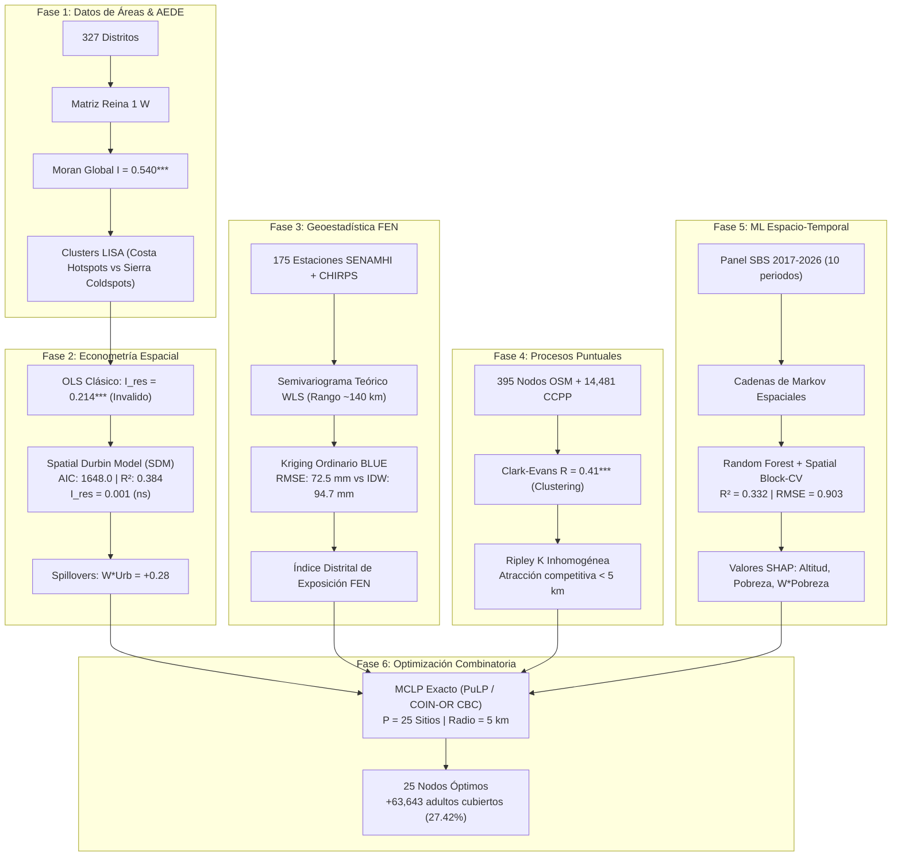

# Memoria Técnica y Documento de Contexto Integral
## Proyecto: GeoBanca Norte Perú 🏦🛰️

> **Documento de transferencia, registro de cambios y memoria técnica del proyecto.**  
> **Fecha de consolidación:** 26 de Octubre de 2026  
> **Autor Principal:** Wilder E. ([@esluw](https://github.com/wilder14-eslu))  
> **Repositorio Oficial:** [https://github.com/wilder14-eslu/geobanca-norte-peru](https://github.com/wilder14-eslu/geobanca-norte-peru)  
> **Demo en Producción (GitHub Pages):** [https://wilder14-eslu.github.io/geobanca-norte-peru/](https://wilder14-eslu.github.io/geobanca-norte-peru/)  
> **Licencia:** MIT  

---

## 1. Resumen Ejecutivo y Pregunta de Negocio

* **Objetivo Estratégico:** Determinar la localización óptima para la expansión de canales financieros (agentes corresponsales, cajeros automáticos y oficinas bancarias) en la Macro Región Norte del Perú, equilibrando **Oportunidad** (brecha poblacional desatendida) y **Riesgo Territorial** (exposición a precipitaciones extremas por el Fenómeno El Niño - FEN).
* **Ámbito Geográfico:** 5 departamentos (**Piura, Lambayeque, La Libertad, Cajamarca y Tumbes**), abarcando **327 distritos** y **7,323,726 habitantes** (5,490,861 adultos 18+).
* **Sistemas de Referencia Cartográficos (CRS):**
  - `EPSG:32717` (UTM Zona 17 Sur, WGS 84): Proyección oficial métrica para buffers euclidianos (5 km), cálculo de áreas y matrices de pesos espaciales.
  - `EPSG:4326` (WGS 84): Proyección geográfica en grados decimales para capas GeoJSON y visores web.
* **Métricas Clave del Ámbito:**
  - **70,560 Corresponsales No Bancarios (CNB):** Canal con mayor capilaridad y costo operativo eficiente.
  - **4,941 Cajeros Automáticos (ATM):** Red física concentrada en cascos urbanos.
  - **629 Oficinas Bancarias Activas:** Registradas formalmente ante la SBS.
  - **5 Desiertos Financieros Absolutos:** Distritos con 0 puntos de atención de cualquier tipo.
  - **25 Puntos Óptimos MCLP ($P=25$):** Ubicaciones estratégicas seleccionadas mediante optimización combinatoria exacta.
  - **+63,643 Adultos Nuevos Cubiertos:** Equivalente al **27.42%** de toda la demanda desatendida rural a $\le 5$ km.

---

## 2. Registro de Cambios y Trabajo Realizado en Esta Sesión

Se ejecutó una modernización y perfeccionamiento integral del proyecto, dividida en dos grandes entregables en producción:

### ENTREGABLE 1: Optimización de la Interfaz y Experiencia de Usuario (UI/UX)
Se desacopló la arquitectura monolítica original de `index.html` en un sistema limpio, moderno y modular:
1. **`index.html`:** Maquetado semántico con Tailwind CSS, FontAwesome 6, Leaflet CSS/JS y MathJax 3.
2. **`style.css`:** Hoja de estilos con efectos *glassmorphism* para paneles flotantes, primera columna pegajosa (`sticky`), badges semafóricos de riesgo FEN, viewport de zoom/arrastre y controles de leyendas.
3. **`app.js`:** Controlador JavaScript que gestiona:
   - Inicialización nativa del mapa Leaflet (sin bloqueos de iframe ni de CORS).
   - **Interacción Bidireccional Tabla $\leftrightarrow$ Mapa:**
     * Al hacer clic en cualquier fila de la tabla MCLP, se ejecuta `map.flyTo([lat, lng], 14, { duration: 1.5 })` suave hacia el centro poblado y se despliega automáticamente el popup con la ficha técnica detallada (demanda en 5 km, porcentaje de riesgo FEN con semáforo, tipología estratégica y robustez climática).
     * Al hacer clic en un marcador en el mapa, se resalta la fila en la tabla (`.mclp-row-active`) y se desplaza el contenedor hacia dicha fila.
   - **Panel Flotante de Control de Capas:** Conmutadores estilizados para prender/apagar:
     * Polígonos distritales con coropletas de brecha de acceso.
     * Inundabilidad / Precipitación Kriging FEN (mm/mes).
     * Densidad total de corresponsales (CNB) y cajeros.
     * Sitios óptimos MCLP ($P=25$) con sus **radios de servicio de 5 km** (círculos translúcidos).
   - **Leyenda Temática Flotante Retráctil:** Sincronizada dinámicamente con las capas activas, con botón de colapso/expansión (`[−] / [+]`).
   - **Modo Pantalla Completa:** Botón nativo que expande el visor y ejecuta `map.invalidateSize()`.
   - **Herramientas de Tabla Avanzadas:**
     * Selector por Departamento + campo de búsqueda en vivo por texto (filtra por centro poblado, distrito o provincia).
     * Badges semafóricos de riesgo FEN (Verde: <30%, Ámbar: 30–60%, Rojo: >60%).
     * Botón funcional "Exportar CSV" que genera y descarga `sitios_optimos_mclp_p25.csv`.
     * Botón funcional "Exportar GeoJSON" que genera y descarga `sitios_optimos_mclp_p25.geojson`.
     * Desplazamiento horizontal con primera columna pegajosa (`table-sticky-col`).
   - **Modales de Figuras Analíticas HD:**
     * Controles de zoom in (`+`), zoom out (`-`) y reset (`1:1`).
     * Soporte de zoom con rueda de ratón y arrastre (*pan & drag*) con cursor `grab`/`grabbing`, tanto para escritorio como para gestos táctiles en móvil.
     * Caja destacada de **"Insight Clave"** debajo del título de cada figura que sintetiza el valor para la toma de decisiones.
4. **`data/distritos_geobanca.js`:** Capa de datos distritales consolidada y precompilada (~450 KB) que permite que la aplicación funcione al 100% tanto en GitHub Pages como al abrir `index.html` en local (`file://`) sin errores de CORS.

### ENTREGABLE 2: Documentación Técnica de Nivel Senior (`README.md`)
Se redactó un nuevo `README.md` exhaustivo y estructurado en 7 secciones:
1. **Header & Badges:** Python 3.10+, PySAL, GeoPandas, PuLP/CBC, Licencia MIT y Demo en GitHub Pages.
2. **Resumen Ejecutivo del Problema & Solución:** Paradoja territorial, métricas cuantitativas clave y tarjetas de resumen.
3. **Arquitectura Metodológica en 6 Fases:**
   - Diagrama de flujo Mermaid que conecta las 6 fases.
   - Fórmulas matemáticas completas en LaTeX (Moran, LISA, especificaciones SDM, semivariograma WLS, Kriging Ordinario, Clark-Evans, Ripley $K$ inhomogénea y modelo combinatorio MCLP MIP).
   - Tablas comparativas de bondad de ajuste (AIC, Pseudo $R^2$, $I_{\text{res}}$).
4. **Estructura del Proyecto:** Árbol ASCII estructurado y descriptivo.
5. **Guía de Reproducibilidad Paso a Paso:** Comandos para `conda`, `venv/pip`, instalación de binarios CBC (`apt`, `brew`, `conda`) y pipeline de ejecución.
6. **CRS y Catálogo de Fuentes:** SBS, INEI (Censo 2025 y Pobreza 2018), SENAMHI (175 estaciones), CHIRPS v2.0, Copernicus DEM 30m y OSM.
7. **Cita Académica (BibTeX) y Autoría:** Formato de citación oficial para publicaciones científicas.

### ENTREGABLE 3: Configuración de Entorno y Control de Versiones
* Se creó el archivo `environment.yml` para reproducción inmediata en entornos Anaconda / Miniconda.
* Se generó la tabla alias `outputs/tablas/sitios_optimos_mclp_p25.csv`.
* Se crearon los commits y se ejecutó `git push origin main` hacia GitHub, disparando el despliegue automático en GitHub Pages.

---

## 3. Síntesis Metodológica de las 6 Fases del Modelo



### Resultados Numéricos Clave por Fase:
1. **Fase 1 (AEDE):** $I = 0.540$ ($p < 0.001$). Los cuadrantes Q1 (Alto-Alto) dominan la costa y Q3 (Bajo-Bajo) la sierra andina.
2. **Fase 2 (Econometría Espacial):**
   - OLS: $\text{AIC} = 1695.6, R^2 = 0.233, I_{\text{res}} = 0.214^{***}$
   - SAR: $\text{AIC} = 1680.3, R^2 = 0.286, \rho = 0.298^{***}$
   - SEM: $\text{AIC} = 1661.7, R^2 = 0.231, \lambda = 0.452^{***}$
   - **SDM:** $\mathbf{\text{AIC} = 1648.0, R^2 = 0.384, \rho = 0.427^{***}, I_{\text{res}} = 0.001\text{ (ns)}}$
3. **Fase 3 (Geoestadística FEN):**
   - Rango del semivariograma: $\approx 140\text{ km}$
   - Validación cruzada LOO (Marzo 1998): IDW $\text{RMSE} = 94.7\text{ mm}$ vs. Kriging Ordinario $\mathbf{\text{RMSE} = 72.5\text{ mm}}$ (reducción de error $>23.4\%$).
4. **Fase 4 (Procesos Puntuales):**
   - Clark-Evans: $R = 0.41$ ($z = -22.4, p < 0.001$), aglomeración intensa en radios menores a 5 km.
5. **Fase 5 (ML Espacio-Temporal):**
   - Markov espacial: Probabilidad de ascenso de estrato se triplica si los vecinos tienen alta cobertura.
   - Spatial Block-CV con Random Forest: $R^2 = 0.332, \text{RMSE} = 0.903$.
6. **Fase 6 (MCLP P=25 con CBC):**
   - Cobertura de la demanda rural insatisfecha: **27.42%** (+63,643 adultos cubiertos en radio de 5 km).
   - 17 de los 25 sitios (68%) resultaron robustos frente a la penalización climática.

---

## 4. Estructura de Archivos del Proyecto

```
geobanca-norte-peru/
├── data/
│   ├── raw/                             # Fuentes originales sin tocar (SBS, INEI, SENAMHI, OSM)
│   ├── interim/                         # Cruces intermedios de UBIGEO y normalizaciones
│   ├── processed/                       # Datasets procesados (base distrital, GeoPackage, panel SBS)
│   └── distritos_geobanca.js            # Capa GeoJSON distrital compilada para la web (~450 KB)
├── notebooks/                           # Flujo analítico secuencial documentado
│   ├── 02_aede.ipynb                    # Fase 1: AEDE, Moran y patrones espaciales
│   ├── 03_pesos_autocorrelacion.ipynb   # Fase 1: Matrices de contigüidad y LISA
│   ├── 04_regresion_espacial.ipynb      # Fase 2: Econometría espacial (OLS, SAR, SEM, SDM)
│   ├── 05_mapas_interactivos.ipynb      # Generación de mapas interactivos Folium
│   ├── 06_geoestadistica_precipitacion.ipynb # Fase 3: Semivariograma y Kriging FEN
│   ├── 07_patrones_puntuales.ipynb      # Fase 4: Clark-Evans, Ripley K y Kernel
│   ├── 08_espaciotemporal_ml.ipynb      # Fase 5: Markov espacial, Spatial Block-CV y SHAP
│   ├── 09_ubicacion_optima.ipynb        # Fase 6: Optimización combinatoria MCLP con CBC
│   └── analisis_integrado.ipynb         # Resumen consolidado de punta a punta
├── outputs/
│   ├── figuras/                         # 29 figuras PNG en alta definición (300 DPI)
│   ├── mapas/                           # Mapas interactivos HTML independientes (Folium)
│   └── tablas/                          # Resultados tabulares de validación y optimización
│       ├── 04_comparacion_modelos.csv   # Comparativa MCO vs SAR vs SEM vs SDM
│       ├── 06_validacion_interpolacion.csv # Validación cruzada LOO (IDW vs Kriging)
│       ├── 09_sitios_mclp_P25.csv       # Solución oficial de los 25 sitios óptimos
│       └── sitios_optimos_mclp_p25.csv  # Alias para descarga directa en la web
├── src/
│   ├── config.py                        # Parámetros globales, CRS y rutas
│   ├── utils_ubigeo.py                  # Normalización de textos y diccionario de UBIGEOs
│   ├── 00_descargar_datos.py            # Script automatizado de descarga reproducible
│   └── 01_construir_base_distrital.py   # Pipeline ETL para construir las capas espaciales
├── docs/                                # Documentación formal, catálogo y referencias
│   ├── catalogo_datos.md                # Metadatos, fuentes, licencias y advertencias
│   ├── guia_senamhi.md                  # Procedimiento de muestreo y acceso a datos climáticos
│   ├── CONTEXTO_PROYECTO.md             # Memoria técnica previa
│   └── informe/                         # Capítulo de informe escrito
├── index.html                           # Aplicación web frontend (Dashboard & Visor SIG)
├── style.css                            # Sistema de diseño, responsive y componentes UI/UX
├── app.js                               # Controlador JS: Leaflet, MCLP flyTo, filtros y exportación
├── environment.yml                      # Especificación del entorno Conda reproducible
├── requirements.txt                     # Dependencias Python vía pip
├── CONTEXTO.md                          # Este archivo: memoria técnica y registro de contexto
└── README.md                            # Documentación principal del repositorio
```

---

## 5. Hoja de Ruta para Próximas Iteraciones

Si en el futuro se desea expandir o continuar el proyecto, se sugieren las siguientes líneas de desarrollo:

1. **Elaboración del Informe Escrito Formal (`docs/informe/`):**
   - Compilar un documento monográfico o *paper* académico en Markdown/LaTeX que desarrolle los 9 capítulos de la investigación (desde la introducción y catálogo de datos hasta las recomendaciones de política de bancarización y resiliencia climática).
2. **Presentación de Diapositivas para Stakeholders (`docs/presentacion/`):**
   - Estructurar una presentación ejecutiva (10–12 diapositivas) orientada a directorios bancarios y reguladores (SBS / MEF / Banco de la Nación), destacando el ahorro de capital y la eficiencia de la corresponsalía resiliente frente a agencias tradicionales.
3. **Proyecto QGIS (`qgis/`):**
   - Empaquetar un archivo `.qgz` con estilos temáticos precargados (*rule-based styling*) para que los analistas SIG puedan consultar las capas directamente en QGIS 3.x.
4. **API Backend Ligera (FastAPI):**
   - Opcionalmente, si se desea permitir al usuario variar interactivamente $P$ (número de sitios) o el radio de cobertura en la web, se puede desplegar un microservicio en FastAPI conectado al solver CBC para resolver el modelo MIP en tiempo real.
