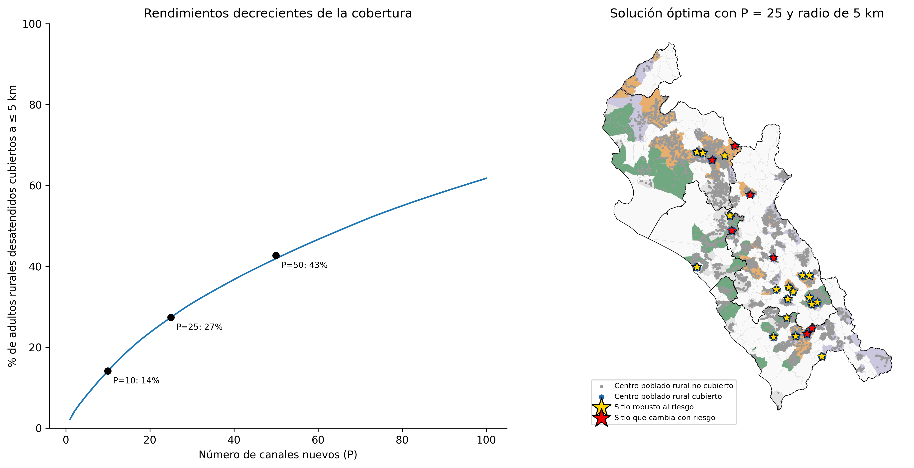
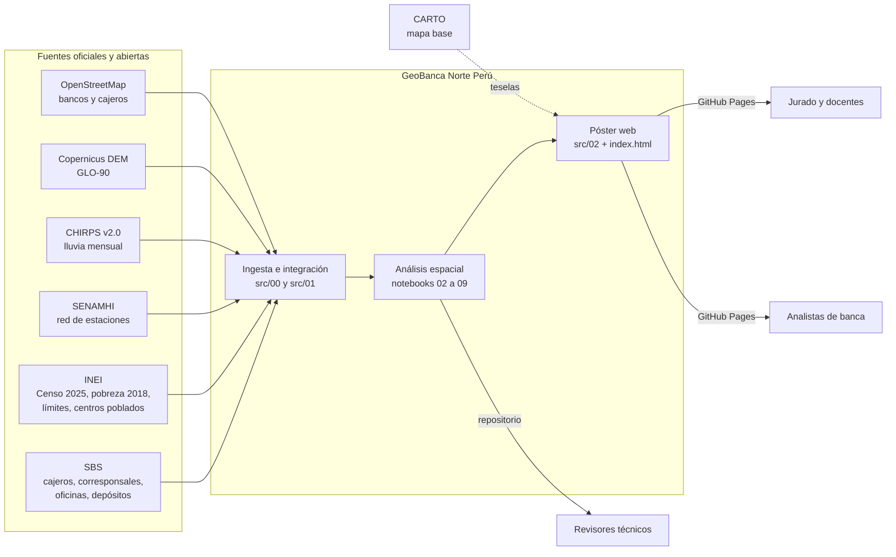
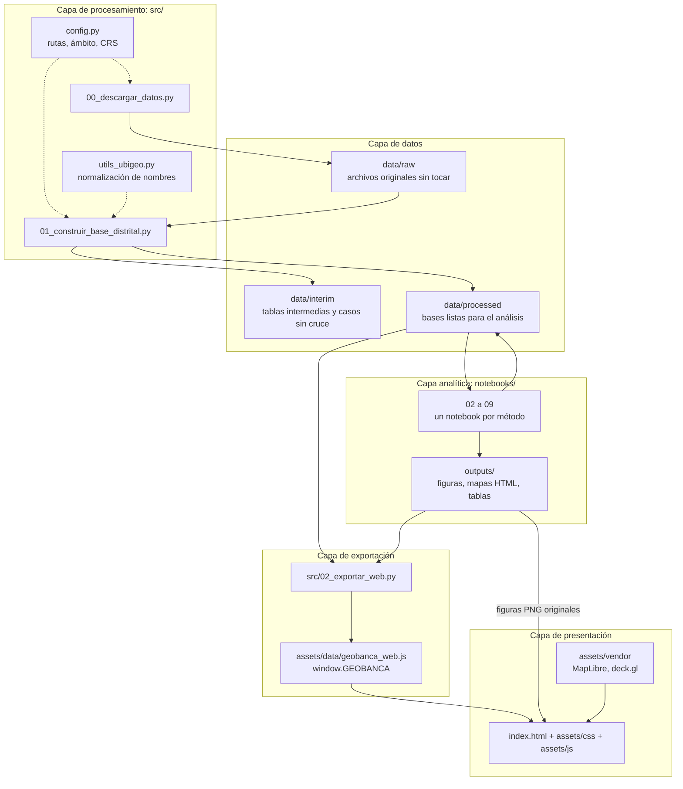
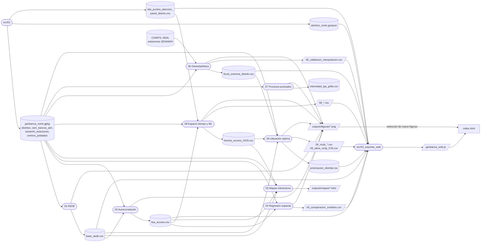
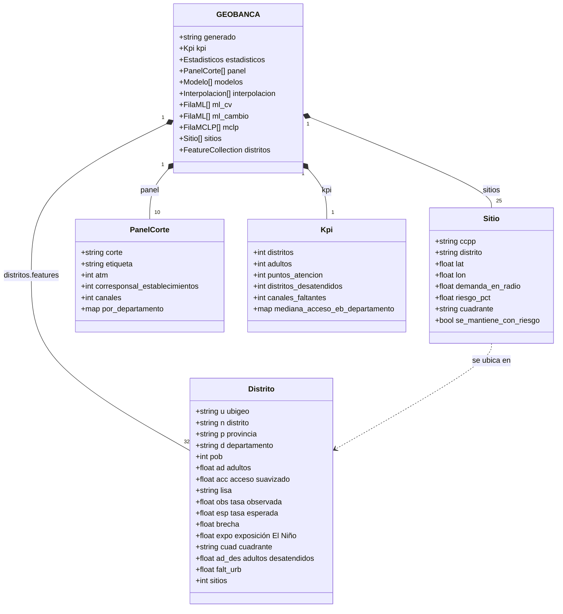
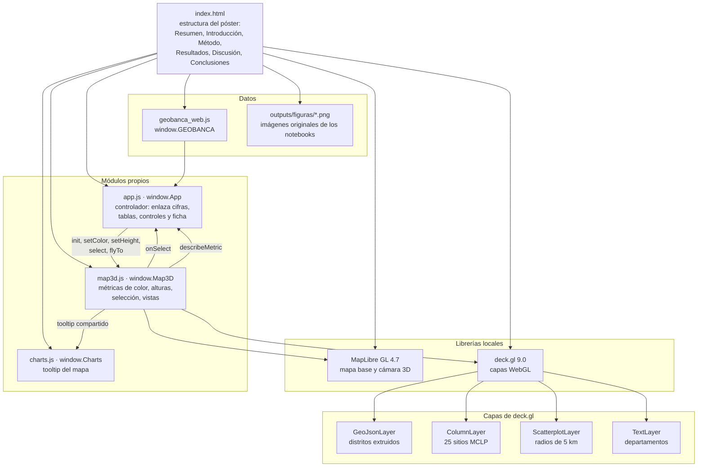
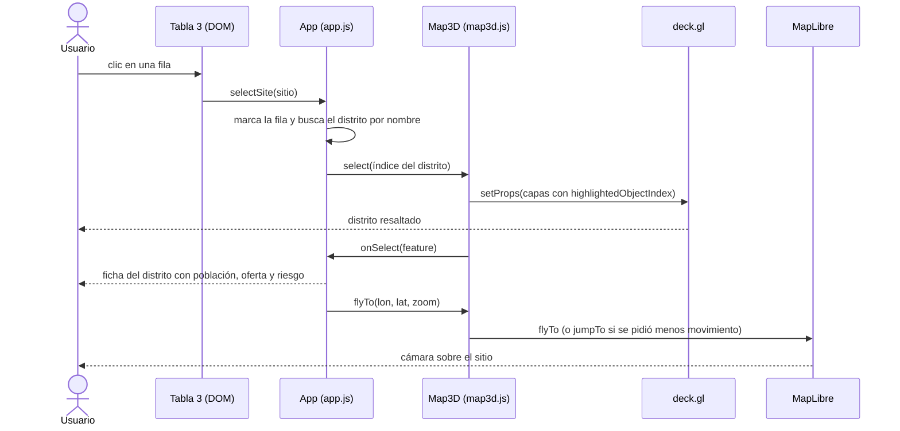
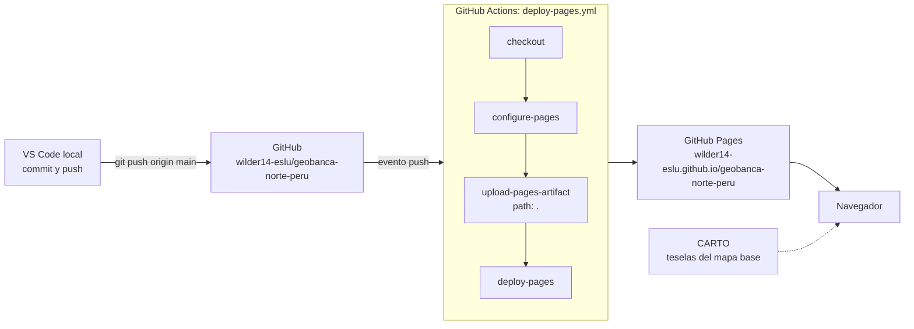
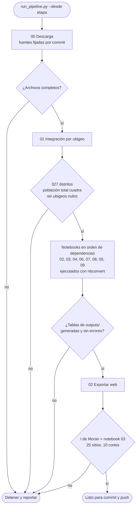

# GeoBanca Norte Perú

**Brechas espaciales de acceso financiero y ubicación óptima de nuevos canales en el norte del Perú**

Análisis de estadística espacial sobre datos oficiales del Perú (SBS, INEI, SENAMHI). Combina dependencia espacial, econometría
espacial, geoestadística de la lluvia de El Niño, procesos puntuales, aprendizaje automático con validación espacial y un modelo
de máxima cobertura para decidir dónde abrir nuevos canales de atención financiera.

[Abrir el póster interactivo](https://wilder14-eslu.github.io/geobanca-norte-peru/) ·
[Consultar los notebooks](notebooks/) · [Descargar los 25 sitios propuestos](outputs/tablas/09_sitios_mclp_P25.csv)



*Figura original de [09_ubicacion_optima.ipynb](notebooks/09_ubicacion_optima.ipynb): curva de cobertura rural y solución
con 25 canales a un radio de 5 km.*

[Resultados](#resultados-principales) · [Póster y figuras](#póster-y-figuras-originales) ·
[Arquitectura](#arquitectura) · [Reproducción](#cómo-reproducir) · [Limitaciones](#limitaciones)

---

## Pregunta

Si una entidad financiera quiere abrir nuevos cajeros, agentes corresponsales u oficinas especiales en la Macro Región Norte
(Tumbes, Piura, Lambayeque, La Libertad y Cajamarca), ¿dónde debería hacerlo?

1. **Oportunidad:** ¿qué distritos tienen menos acceso del que les corresponde?
2. **Explicación:** ¿qué factores sociales y espaciales explican ese acceso?
3. **Riesgo:** ¿qué zonas están más expuestas a la lluvia extrema de El Niño?
4. **Decisión:** ¿dónde ubicar los nuevos canales para cubrir a más adultos desatendidos?

## Ámbito y datos

| Unidad | Valor |
|---|---|
| Distritos | 327 |
| Población 2025 | 7 323 726 |
| Adultos (18 años o más, estimados) | 5 490 861 |
| Puntos de atención en la base integrada | 76 143: 4 941 cajeros, 70 560 agentes corresponsales, 629 oficinas y 13 EOB |
| Panel SBS | 10 cortes, de diciembre de 2017 a marzo de 2026 |
| Centros poblados georreferenciados | 14 481 |
| Sitios financieros georreferenciados en OSM | 395 |
| Estaciones SENAMHI en la capa base | 175 meteorológicas de la red actual |
| Estaciones usadas en el notebook 06 | 235 de la red actual e histórica, agrupadas en 149 píxeles CHIRPS |

La base integra cajeros, corresponsales y EOB de marzo de 2026 con oficinas de diciembre de 2025. El panel temporal
suma cajeros, corresponsales y EOB; no incluye oficinas. Los conteos de la capa base pueden consultarse en el
[reporte de verificación](outputs/tablas/reporte_verificacion.txt), y la red combinada de estaciones se documenta en el
[notebook 06](notebooks/06_geoestadistica_precipitacion.ipynb).

Fuentes: SBS (Boletín Estadístico), INEI (Censo 2025, Mapa de Pobreza 2018, límites, ubigeos y centros poblados), SENAMHI,
CHIRPS v2.0, Copernicus DEM GLO-90 y OpenStreetMap. Detalle, licencias y advertencias en
[`docs/catalogo_datos.md`](docs/catalogo_datos.md).

## Resultados principales

Las cifras resumen los resultados guardados en los [notebooks](notebooks/), sus bases de `data/processed/` y las
[tablas exportadas](outputs/tablas/). Se presentan con el redondeo usado en el estudio.

**1. Hay oferta, pero mal repartida** ([02](notebooks/02_aede.ipynb) y [03](notebooks/03_pesos_autocorrelacion.ipynb))

- El ámbito tiene 138,7 puntos de atención por 10 mil adultos, pero la mediana distrital es 102. 237 distritos no tienen
  cajero automático, 197 no tienen oficina y 5 no tienen ningún canal.
- El acceso está espacialmente agrupado: I de Moran = 0,277 (p = 0,001) y C de Geary = 0,72, con el mismo resultado en cuatro
  matrices de pesos. Hay 34 distritos Alto-Alto en la costa de Piura y Tumbes y 19 desiertos financieros Bajo-Bajo
  (212 mil habitantes), casi todos en la sierra de Cajamarca y de Piura.

**2. Pobreza, urbanización y entorno explican el acceso** ([notebook 04](notebooks/04_regresion_espacial.ipynb))

| Modelo | AIC | Pseudo R² | I de Moran de residuos | Parámetro espacial |
|---|---:|---:|---:|---:|
| OLS | 1695,6 | 0,233 | 0,214 | |
| SAR | 1680,3 | 0,286 | 0,045 | ρ = 0,298 |
| SEM | 1661,7 | 0,231 | -0,016 | λ = 0,452 |
| SDM | 1648,0 | 0,384 | 0,001 | ρ = 0,427 |

- Las pruebas LM robustas favorecen el error espacial (LM-error 31,4 frente a LM-rezago 15,3). El SDM logra el menor AIC y la
  prueba de factor común rechaza reducirlo al SEM (p = 0,0004).
- En OLS y en SAR, SEM y SDM estimados por máxima verosimilitud, la pobreza se asocia con menor acceso y la urbanización con
  mayor acceso (p < 0,05). En el SDM, el efecto indirecto de la urbanización es negativo, según los impactos estimados.

Fuente: [comparación de modelos](outputs/tablas/04_comparacion_modelos.csv). La respuesta es la raíz cuadrada del acceso
suavizado; los efectos directos e indirectos se desarrollan en el notebook 04.

**3. Dónde golpea El Niño** ([notebook 06](notebooks/06_geoestadistica_precipitacion.ipynb))

- Se usa CHIRPS como campo de referencia y se extraen sus valores en los píxeles con estaciones SENAMHI. La precipitación
  analizada procede de esos píxeles, no de registros diarios descargados de los pluviómetros.
- El logaritmo de la lluvia de marzo de 1998 tiene un semivariograma gaussiano con rango práctico de 147 km y anisotropía costa-sierra.
- El kriging ordinario reduce el RMSE de validación cruzada frente a IDW en los tres eventos:

  | Evento | IDW | Kriging ordinario | Kriging con deriva (altitud) |
  |---|---:|---:|---:|
  | Marzo 1998 | 94,7 mm | 72,5 mm | 74,8 mm |
  | Marzo 2017 | 136,9 mm | 95,3 mm | 98,6 mm |
  | Marzo 2023 | 111,1 mm | 94,1 mm | 94,9 mm |

- Los distritos más expuestos están en Tumbes (Matapalo, Pampas de Hospital, Casitas, Papayal) y en la sierra de Piura
  (Lancones, Suyo). El índice de exposición se calcula agregando el campo CHIRPS por distrito y combinando los tres eventos.

Fuente: [validación de los interpoladores](outputs/tablas/06_validacion_interpolacion.csv).

**4. La oferta se apila en los mismos lugares** ([notebook 07](notebooks/07_patrones_puntuales.ipynb))

- En Trujillo metropolitano (92 sitios), Clark-Evans R = 0,41 (z = -10,9): la distancia media al vecino más cercano es 224 m
  frente a 552 m bajo aleatoriedad completa. Alto Trujillo y Florencia de Mora casi no tienen oferta visible en OSM.
- En el análisis regional de los sitios OSM, la K no homogénea supera la envolvente entre 0,5 y 2,8 km: persiste
  agrupamiento después de controlar la intensidad estimada. La cobertura parcial de OSM limita la interpretación al patrón observado.

**5. La red creció sin reducir la segregación** ([notebook 08](notebooks/08_espaciotemporal_ml.ipynb))

- Los canales pasaron de 22 729 (diciembre de 2017) a 87 820 (diciembre de 2023) y bajaron a 73 319 (diciembre de 2025).
  La caída de 2024 ocurre en los cinco departamentos a la vez.
- El I de Moran anual se mantiene entre 0,20 y 0,24. En la cadena de Markov espacial, un distrito del segundo quintil sube con
  probabilidad 0,36 si sus vecinos están en el quintil más alto y 0,12 si están en el segundo; el quintil más bajo es el más
  persistente (0,79).
- Con validación cruzada espacial por provincias, el Random Forest con rezagos espaciales y posición alcanza R² = 0,33.
  En la validación del cambio anual, ningún modelo mejora a la persistencia: RMSE promedio de 0,559 para persistencia y
  0,560 para Random Forest.

Fuentes: [validación espacial del acceso potencial](outputs/tablas/08_acceso_potencial_cv_espacial.csv) y
[predicción del cambio anual](outputs/tablas/08_prediccion_cambio_anual.csv).

**6. Dos déficits distintos y dónde abrir** ([notebook 09](notebooks/09_ubicacion_optima.ipynb))

- 147 distritos tienen menos acceso del esperado por su estructura. El modelo estima una brecha equivalente a 9 466 canales
  y 768 023 adultos desatendidos.
- La mayor parte del déficit es urbano (7 777 canales). Siete distritos (Veintiséis de Octubre, Pariñas, Castilla,
  Alto Trujillo, Chulucanas, Paita y Tambo Grande) explican el 55% del total: en la ciudad falta capacidad, no cercanía.
- La estimación distrital suma 234 273 adultos rurales desatendidos. De ellos, 232 136 se asignan a centros poblados rurales
  georreferenciados y constituyen la demanda del MCLP. La solución exacta con CBC cubre a 5 km o menos:

  | Canales nuevos | Cobertura exacta | Heurística voraz |
  |---:|---:|---:|
  | 10 | 14,1% | 14,1% |
  | 25 | 27,4% | 27,4% |
  | 50 | 42,7% | 41,9% |

- Con 25 canales, la solución cubre aproximadamente 63 643 adultos de la demanda rural asignada.
- Al descontar la demanda por riesgo climático, 18 de los 25 sitios son idénticos y 20 quedan a 5 km o menos de algún sitio
  de la solución base. La cobertura de la demanda original baja de 27,4% a 27,0%.

Fuentes: [comparación de cobertura exacta y voraz](outputs/tablas/09_mclp_exacto_vs_voraz.csv) y
[coordenadas y atributos de los 25 sitios](outputs/tablas/09_sitios_mclp_P25.csv).
La demanda en el radio de cada sitio puede solaparse con la de otros; su suma no equivale al total de adultos cubiertos.

## Limitaciones

- La SBS reporta los corresponsales por entidad: un mismo comercio puede contarse más de una vez.
- La población adulta distrital se estima aplicando la proporción de adultos de su provincia a la población total del
  distrito. Los tabulados de edad utilizados llegan al nivel provincial.
- El mapa de pobreza utilizado corresponde a 2018, siete años antes del Censo 2025.
- La demanda rural se reparte en partes iguales entre los caseríos de cada distrito, porque la base no trae población por
  centro poblado.
- La distancia del MCLP es en línea recta, no por red vial.
- El acceso esperado proviene de un modelo con R² cercano a 0,33, así que la brecha de cada distrito tiene incertidumbre.
- El índice climático mide lluvia extrema, no huaicos ni cortes de vía. El ejercicio de interpolación evalúa la geometría
  de la red SENAMHI sobre el campo CHIRPS; sus valores en estaciones no son observaciones independientes del satélite.
- Los puntos OSM representan la oferta georreferenciada disponible y no un inventario completo de la red reportada por la SBS.

## Póster y figuras originales

El [póster web](https://wilder14-eslu.github.io/geobanca-norte-peru/) reúne un mapa de los 327 distritos con vistas 3D y cenital,
búsqueda por distrito, fichas de indicadores y selección de métricas de acceso, brecha, LISA, exposición y prioridad.
La tabla de los 25 sitios permite ordenar columnas, filtrar los que se mantienen en el escenario con riesgo y ubicarlos en el mapa.

Las nueve figuras de resultados se cargan directamente desde `outputs/figuras/`, conservando las imágenes exportadas por
los notebooks. Cada una permite abrir la imagen completa y descargar el notebook de origen. El póster no crea figuras
ni datos adicionales para completar el relato; sus indicadores y tablas utilizan los resultados del proyecto.

| Figura en el póster | Imagen original | Notebook de origen |
|---|---|---|
| 2. Acceso y contexto socioeconómico | [02_mapas_tematicos.png](outputs/figuras/02_mapas_tematicos.png) | [02 · AEDE](notebooks/02_aede.ipynb) |
| 3. Clusters LISA y significancia local | [03_lisa_acceso.png](outputs/figuras/03_lisa_acceso.png) | [03 · Autocorrelación](notebooks/03_pesos_autocorrelacion.ipynb) |
| 4. Evolución de canales y Moran | [08_evolucion_moran.png](outputs/figuras/08_evolucion_moran.png) | [08 · Espacio-tiempo y ML](notebooks/08_espaciotemporal_ml.ipynb) |
| 5. Residuos OLS y SEM | [04_residuos_ols_sem.png](outputs/figuras/04_residuos_ols_sem.png) | [04 · Regresión espacial](notebooks/04_regresion_espacial.ipynb) |
| 6. SHAP del modelo XGBoost | [08_shap_acceso_potencial.png](outputs/figuras/08_shap_acceso_potencial.png) | [08 · Espacio-tiempo y ML](notebooks/08_espaciotemporal_ml.ipynb) |
| 7. Validación de lluvia de 1998 y error por distancia | [06_validacion.png](outputs/figuras/06_validacion.png) | [06 · Geoestadística](notebooks/06_geoestadistica_precipitacion.ipynb) |
| 8. Acceso observado, esperado y brecha | [08_brecha_acceso.png](outputs/figuras/08_brecha_acceso.png) | [08 · Espacio-tiempo y ML](notebooks/08_espaciotemporal_ml.ipynb) |
| 9. Cobertura rural y sitios MCLP | [09_mclp_cobertura.png](outputs/figuras/09_mclp_cobertura.png) | [09 · Ubicación óptima](notebooks/09_ubicacion_optima.ipynb) |
| 10. Oportunidad y riesgo | [09_matriz_oportunidad_riesgo.png](outputs/figuras/09_matriz_oportunidad_riesgo.png) | [09 · Ubicación óptima](notebooks/09_ubicacion_optima.ipynb) |

La figura 1 es el explorador territorial. Los mapas Folium del [notebook 05](notebooks/05_mapas_interactivos.ipynb)
se conservan como salidas independientes en [`outputs/mapas/`](outputs/mapas/).

### Abrir el póster en local

Desde la raíz de una copia del repositorio, con Python instalado:

```powershell
python -m http.server 8000 --bind 127.0.0.1
```

Abre [http://127.0.0.1:8000](http://127.0.0.1:8000). Los recursos del póster ya están incluidos en el repositorio, así que
para consultarlo no hace falta ejecutar los notebooks ni instalar las dependencias de análisis. Las figuras se muestran
incluso sin JavaScript; el mapa, las tablas y los indicadores requieren JavaScript, y el mapa 3D requiere WebGL.
Las teselas del mapa base de CARTO necesitan conexión; las figuras, los datos y las librerías del póster se sirven localmente.

## Notebooks

| Notebook | Etapa | Métodos |
|---|---|---|
| [`02_aede`](notebooks/02_aede.ipynb) | Análisis exploratorio | Bayes empírico, boxmap, centrografía |
| [`03_pesos_autocorrelacion`](notebooks/03_pesos_autocorrelacion.ipynb) | Dependencia espacial | Matrices de pesos, Moran, Geary, LISA, Gi*, Moran bivariado |
| [`04_regresion_espacial`](notebooks/04_regresion_espacial.ipynb) | Modelos de áreas | OLS y pruebas LM, SAR, SEM (ML y GMM), SDM e impactos |
| [`05_mapas_interactivos`](notebooks/05_mapas_interactivos.ipynb) | Comunicación | Mapas folium con capas y fichas por distrito |
| [`06_geoestadistica_precipitacion`](notebooks/06_geoestadistica_precipitacion.ipynb) | Geoestadística | Semivariograma, anisotropía, IDW, kriging ordinario y con deriva externa |
| [`07_patrones_puntuales`](notebooks/07_patrones_puntuales.ipynb) | Procesos puntuales | Cuadrantes, Clark-Evans, G, F, K y L, kernel, Poisson no homogéneo |
| [`08_espaciotemporal_ml`](notebooks/08_espaciotemporal_ml.ipynb) | Espacio-tiempo y ML | Markov espacial, origen móvil, Ridge, Random Forest, XGBoost, SHAP |
| [`09_ubicacion_optima`](notebooks/09_ubicacion_optima.ipynb) | Decisión | Matriz oportunidad por riesgo, MCLP exacto y voraz, sensibilidad |

## Estructura

```
geobanca-norte-peru/
├── index.html                 póster web interactivo (GitHub Pages)
├── assets/
│   ├── css/  js/              estilos, mapa 3D (MapLibre + deck.gl) y controles
│   ├── data/geobanca_web.js   datos del póster, generados por src/02_exportar_web.py
│   ├── img/  fonts/  vendor/  escudo, tipografía Archivo y librerías locales
├── data/
│   ├── raw/                   fuentes originales (se descargan con src/00_descargar_datos.py)
│   ├── interim/               tablas intermedias y casos sin cruce de ubigeo
│   └── processed/             bases listas para el análisis
├── notebooks/                 un notebook por etapa del análisis
├── src/
│   ├── config.py              rutas, ámbito y sistemas de referencia
│   ├── utils_ubigeo.py        normalización de nombres y asignación de ubigeo
│   ├── 00_descargar_datos.py  descarga reproducible de las fuentes
│   ├── 01_construir_base_distrital.py  integración por ubigeo y capas espaciales
│   └── 02_exportar_web.py     exporta los resultados de los notebooks al póster
├── outputs/                   figuras, mapas HTML y tablas
└── docs/                      catálogo de datos, guía SENAMHI e imágenes
```

## Arquitectura

Cómo está construido el proyecto: de dónde vienen los datos, cómo fluyen entre los scripts y los notebooks, cómo funciona el póster web y cómo se publica.

### Contexto del sistema

Quién entrega datos al sistema y quién consume sus resultados.



### Arquitectura por capas

Los scripts integran las fuentes; los notebooks producen bases, tablas y figuras. El exportador prepara los datos
del mapa y los indicadores, mientras que las figuras llegan directamente desde las salidas de los notebooks al HTML.



### Flujo de datos entre etapas

Principales archivos de entrada y salida entre las etapas, según el código de los notebooks.



Orden de ejecución que respeta las dependencias: `01 → 02 → 03 → 04 → 06 → 07 → 08 → 05 → 09 → exportar_web`.
El notebook 05 va después del 08 porque usa la brecha de acceso que el 08 calcula.

### Modelo de datos del póster

Estructura de `window.GEOBANCA`, el único archivo de datos que lee la web. Los nombres de propiedad de cada distrito son cortos
para que el archivo pese menos (442 KB con las 327 geometrías simplificadas).



### Componentes del frontend

La web es estática y se sirve desde GitHub Pages o un servidor HTTP local, sin backend de aplicación ni base de datos.
`app.js` enlaza los indicadores y las tablas, y coordina el mapa. Las figuras se declaran como imágenes en `index.html`;
`charts.js` se utiliza para los mensajes emergentes del mapa, sin registrar gráficos de resultados.



### Interacción en el póster

Qué pasa cuando alguien selecciona un sitio en la Tabla 3. El clic en un distrito del mapa sigue el mismo camino desde
`Map3D.select`.



### Despliegue

El workflow [deploy-pages.yml](.github/workflows/deploy-pages.yml) publica el contenido del repositorio en GitHub Pages
con cada push a `main` o por ejecución manual. El despliegue utiliza las salidas guardadas: no ejecuta notebooks ni
regenera `geobanca_web.js`. Las figuras y los datos que se quieran publicar deben estar actualizados en el commit.



Las figuras, los datos, las librerías, la tipografía y el escudo están incluidos en el repositorio. Al servir la copia
local por HTTP, esos recursos siguen disponibles sin internet; las teselas de CARTO requieren conexión.

### Pipeline orquestado (propuesta)

Hoy cada etapa se ejecuta a mano. Esta es la propuesta para un `run_pipeline.py` que ejecute todo en orden, valide la salida
de cada etapa y se detenga ante el primer error, para que un dato roto nunca llegue al póster. **Todavía no está implementado.**



### Decisiones de diseño

| Decisión | Alternativa descartada | Motivo |
|---|---|---|
| Sitio estático en GitHub Pages | Servidor con API (Flask, Node) | El navegador consulta archivos del repositorio; no requiere mantener un backend de aplicación. |
| Indicadores exportados por `02_exportar_web.py` | Copiar cifras manualmente al HTML | Centraliza los datos que consumen el mapa, las tablas y los indicadores. |
| Figuras originales de `outputs/figuras/` | Redibujar gráficos en JavaScript | Mantiene los resultados visuales de los notebooks y permite consultar su procedencia. |
| Librerías y tipografía dentro del repo | Cargarlas desde un CDN | El póster funciona sin internet durante la exposición. |
| MapLibre + deck.gl | Leaflet o folium | Extrusión 3D por WebGL, cámara con inclinación y rotación, y miles de polígonos fluidos. |
| Geometrías simplificadas a 350 m | GeoJSON completo (7,6 MB) | 442 KB en total; a escala regional la diferencia no se ve. |
| Dos sistemas de referencia | Uno solo | EPSG:4326 para intercambio y web; EPSG:32717 (UTM 17S) para distancias, áreas, kriging y el MCLP. |
| Ubigeo INEI de 6 dígitos como llave | Unir por nombre de distrito | Los nombres cambian de escritura entre fuentes; el ubigeo no. `utils_ubigeo.py` resuelve los casos que solo traen nombre. |
| Un notebook por método | Un solo notebook largo | Cada etapa se revisa, corrige y vuelve a ejecutar sin rehacer todo. |

## Cómo reproducir

### Preparar el entorno

Los siguientes comandos usan PowerShell en Windows y se ejecutan desde la raíz del repositorio:

```powershell
git clone https://github.com/wilder14-eslu/geobanca-norte-peru.git
cd geobanca-norte-peru
python -m venv .venv
.\.venv\Scripts\python.exe -m pip install -r requirements.txt
.\.venv\Scripts\python.exe -m pip install jupyterlab giddy
```

Se usa el ejecutable del entorno virtual directamente, sin necesidad de activarlo. En Linux o macOS, sustituye
`.\.venv\Scripts\python.exe` por `.venv/bin/python`. JupyterLab permite abrir los notebooks; `giddy` es una dependencia
que importa el notebook 08 y que actualmente no está incluida en `requirements.txt`.

### Descargar e integrar las fuentes

```powershell
.\.venv\Scripts\python.exe src/00_descargar_datos.py --chirps --dem
.\.venv\Scripts\python.exe src/01_construir_base_distrital.py
```

El primer comando descarga las fuentes base, los campos CHIRPS y el DEM que necesita el notebook 06. El segundo genera
la base distrital, el panel SBS y las capas de `data/processed/geobanca_norte.gpkg`. Las fuentes crudas y las capas pesadas
excluidas por `.gitignore` deben reconstruirse antes de ejecutar el análisis.

### Ejecutar los notebooks

```powershell
.\.venv\Scripts\python.exe -m jupyterlab
```

Ejecuta todas las celdas de cada notebook, guarda sus resultados y sigue este orden:

`02 → 03 → 04 → 06 → 07 → 08 → 05 → 09`

El notebook 05 necesita la brecha que genera el 08; el 09 necesita las salidas de 02, 06 y 08. El MCLP utiliza PuLP con
el solver CBC, invocado mediante `PULP_CBC_CMD`. La ejecución produce las figuras en `outputs/figuras/`, las tablas en
`outputs/tablas/` y las bases analíticas en `data/processed/`.

### Actualizar y revisar el póster

```powershell
.\.venv\Scripts\python.exe src/02_exportar_web.py
.\.venv\Scripts\python.exe -m http.server 8000 --bind 127.0.0.1
```

El exportador genera [`assets/data/geobanca_web.js`](assets/data/geobanca_web.js) a partir de las bases y tablas del
proyecto. También recalcula el I de Moran con contigüidad Reina sobre la variable exportada por el notebook 03.
Las imágenes las generan los notebooks; el exportador web no las modifica.

Abre [http://127.0.0.1:8000](http://127.0.0.1:8000) y contrasta los indicadores, las tablas y las nueve figuras con sus
notebooks de origen. Si cambian los resultados, revisa también el texto de `index.html` y de este README: las
interpretaciones escritas no se actualizan automáticamente al exportar los datos.

## Notas sobre los datos

- Las fuentes alojadas en GitHub están fijadas a commits en `src/00_descargar_datos.py`. Las descargas de otros servicios
  dependen de su disponibilidad y de los archivos que publiquen.
- OpenStreetMap es una foto al 16/10/2026; `--osm-actualizar` vuelve a consultarlo y los conteos pueden cambiar.
- Los registros diarios de SENAMHI requieren registro por estación. El notebook 06 usa CHIRPS como campo de referencia y las
  coordenadas reales de la red SENAMHI como diseño de muestreo (ver [`docs/guia_senamhi.md`](docs/guia_senamhi.md)).
- La verificación del cruce por ubigeo está en el [reporte de verificación](outputs/tablas/reporte_verificacion.txt).
- `requirements.txt` establece versiones mínimas y no fija un entorno completo; las versiones instaladas pueden influir
  en los resultados al volver a ejecutar el análisis.

## Autores

Briceño Ypanaque, Gabriel Alberto · Espinoza Luna, Wilder Gilmer · Isase Camara, Vicente Edgar · Montoya Juro, Oscar Alberto ·
Pablo Machaca, Gerson Alexis · Polastre Mamani, Frank

Escuela Profesional de Estadística, Universidad Nacional Mayor de San Marcos.

Los datos conservan las licencias de sus fuentes originales; ver [`docs/catalogo_datos.md`](docs/catalogo_datos.md).
