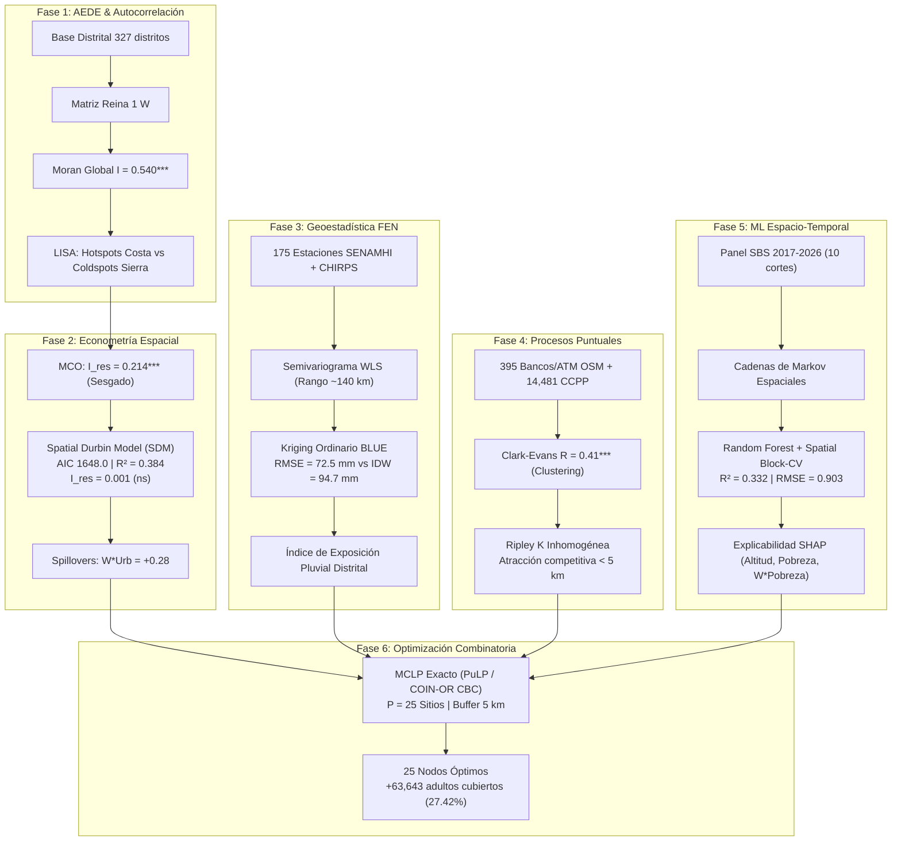

# GeoBanca Norte Perú 🏦🛰️
### Estrategia Geoespacial Multicriterio para la Expansión de Canales Financieros y Mitigación del Riesgo Climático (FEN)

[](https://www.python.org/)
[](https://pysal.org/)
[](https://geopandas.org/)
[](https://github.com/coin-or/Cbc)
[](LICENSE)
[](https://wilder14-eslu.github.io/geobanca-norte-peru/)
[]()

> **Marco analítico integral y reproducible** que combina Análisis Exploratorio de Datos Espaciales (**AEDE**), Econometría Espacial (**SDM**), Geoestadística de Lluvias Extremas (**Kriging Ordinario**), Procesos Puntuales Espaciales (**Ripley $K$ inhomogénea**), Aprendizaje Automático con Validación Espacial (**Spatial Block-CV + SHAP**) y Optimización Combinatoria de Localización (**MCLP Exacto con solver CBC**) para resolver la localización óptima de puntos de atención financiera en la Macro Región Norte del Perú.

---

## 📑 Tabla de Contenidos

1. [Resumen Ejecutivo del Problema & Solución](#1-resumen-ejecutivo-del-problema--solución)
2. [Métricas Clave Consolidadas](#2-métricas-clave-consolidadas)
3. [Arquitectura Metodológica en 6 Fases](#3-arquitectura-metodológica-en-6-fases)
   - [Fase 1: Datos de Áreas y AEDE (Moran & LISA)](#fase-1-datos-de-áreas-y-aede-moran--lisa)
   - [Fase 2: Econometría Espacial de Áreas (MCO vs SEM/SAR vs SDM)](#fase-2-econometría-espacial-de-áreas-mco-vs-semsar-vs-sdm)
   - [Fase 3: Geoestadística del Riesgo Pluviométrico FEN (Kriging vs IDW)](#fase-3-geoestadística-del-riesgo-pluviométrico-fen-kriging-vs-idw)
   - [Fase 4: Procesos Puntuales Espaciales (Clark-Evans & Ripley K)](#fase-4-procesos-puntuales-espaciales-clark-evans--ripley-k)
   - [Fase 5: Dinámica Espacio-Temporal, ML y Explicabilidad SHAP](#fase-5-dinámica-espacio-temporal-ml-y-explicabilidad-shap)
   - [Fase 6: Optimización Combinatoria Territorial (MCLP Exacto con CBC)](#fase-6-optimización-combinatoria-territorial-mclp-exacto-con-cbc)
4. [Estructura del Repositorio](#4-estructura-del-repositorio)
5. [Guía de Reproducibilidad Paso a Paso](#5-guía-de-reproducibilidad-paso-a-paso)
6. [Sistemas de Referencia de Coordenadas (CRS) y Fuentes de Datos](#6-sistemas-de-referencia-de-coordenadas-crs-y-fuentes-de-datos)
7. [Cita Académica (BibTeX) y Autoría](#7-cita-académica-bibtex-y-autoría)

---

## 1. Resumen Ejecutivo del Problema & Solución

### El Desafío Territorial en la Macro Región Norte
La Macro Región Norte del Perú —comprendida por los departamentos de **Piura, Lambayeque, La Libertad, Cajamarca y Tumbes**— abarca **327 distritos**, una superficie de más de 136,000 km² y **7,323,726 habitantes** (de los cuales 5,490,861 son adultos mayores de 18 años). 

A pesar de su trascendencia macroeconómica, el territorio manifiesta una **profunda paradoja de inclusión financiera**:
1. **Hiperconcentración en la Franja Costera:** Ciudades metropolitanas como Trujillo, Chiclayo y Piura concentran más del 75% de cajeros automáticos (ATMs) y agencias bancarias, operando bajo lógicas de aglomeración competitiva con redundancia en cascos cívicos y desabastecimiento periurbano.
2. **Trampas de Exclusión Andina:** Las provincias altoandinas de Cajamarca y las sierras de Piura (Ayabaca y Huancabamba) presentan tasas de cobertura extremadamente deficientes, configurando **desiertos financieros absolutos** y bolsones de pobreza monetaria estructural (> 70%).
3. **Vulnerabilidad Catastrófica ante el Fenómeno El Niño (FEN):** Los episodios extraordinarios de El Niño (1998, 2017 y 2023) descargan precipitaciones superiores a los 500–800 mm/mes en las llanuras costeras y piedemonte, provocando desbordes de ríos, corte de carreteras, corte eléctrico y colapso de redes de telecomunicaciones. Instalar canales físicos convencionales en zonas de alta susceptibilidad a inundaciones genera cuantiosas pérdidas de capital y la interrupción del acceso precisamente durante las emergencias humanitarias.

### La Solución: Inteligencia Territorial Integral
Este proyecto articula una **estrategia de optimización biofísica y económica**. En lugar de asignar puntos mediante heurísticas empíricas o criterios exclusivamente comerciales, formula un modelo de Programación Entera Mixta (MIP) de **Máxima Cobertura con Localización (MCLP)** que maximiza la población adulta desatendida cubierta a una distancia reglamentaria de 5 km, restringiendo o adaptando tecnológicamente la localización en función del percentil de riesgo pluvial derivado de campos continuos de Kriging Ordinario.

---

## 2. Métricas Clave Consolidadas

| Métrica Territorial / Modelo | Magnitud Oficial | Impacto Analítico / Fuente |
|---|:---:|---|
| **Distritos Analizados** | **327 distritos** | Cobertura censal exhaustiva en 5 departamentos |
| **Población Total (Censo 2025)** | **7,323,726 hab.** | 5,490,861 adultos (18+ años) como población objetivo |
| **Corresponsales No Bancarios (CNBs)** | **70,560 puntos** | Canal de mayor capilaridad y viabilidad en zonas rurales (SBS 2026) |
| **Cajeros Automáticos (ATMs)** | **4,941 terminales** | Red física concentrada en nodos urbanos consolidados |
| **Oficinas Bancarias Formales** | **629 oficinas** | Registro oficial SBS con depósitos y colocaciones distritales |
| **Desiertos Financieros Absolutos** | **5 distritos** | 0 canales de ningún tipo (requieren banca pública o móvil) |
| **Centros Poblados Evaluados** | **14,481 CCPP** | Universo de demanda georreferenciado del INEI |
| **Estaciones Meteorológicas** | **175 estaciones** | Red oficial SENAMHI con registros históricos de precipitación |
| **Sitios Óptimos Seleccionados ($P = 25$)** | **25 centros poblados** | Solución exacta MIP resuelta con el solver COIN-OR CBC |
| **Población Rural Nueva Cubierta** | **+63,643 adultos** | **27.42%** de toda la demanda insatisfecha rural norteña a $\le 5$ km |

---

## 3. Arquitectura Metodológica en 6 Fases



---

### Fase 1: Datos de Áreas y AEDE (Moran & LISA)
* **Objetivo:** Contrastar formalmente la hipótesis nula de aleatoriedad espacial en el acceso financiero distrital y mapear clusters territoriales de inclusión y exclusión.
* **Variable analizada:** Tasa de puntos de atención por cada 10,000 adultos, suavizada mediante el Estimador Empírico de Bayes (EB) para corregir la inestabilidad por varianza en distritos de baja población.
* **Matriz de Pesos Espaciales ($W$):** Contigüidad Reina (*Queen*) de primer orden, estandarizada por filas ($\sum_j w_{ij} = 1$).
* **Moran Global:**
  $$I = \frac{n}{\sum_{i=1}^n \sum_{j=1}^n w_{ij}} \frac{\sum_{i=1}^n \sum_{j=1}^n w_{ij} (y_i - \bar{y})(y_j - \bar{y})}{\sum_{i=1}^n (y_i - \bar{y})^2} = \mathbf{0.540} \quad (p < 0.001, \text{ 999 permutaciones})$$
  Rechaza concluyentemente la dispersión aleatoria, confirmando una fuerte autocorrelación espacial positiva.
* **Indicadores Locales de Asociación Espacial (LISA de Anselin):**
  $$I_i = \frac{z_i}{s^2} \sum_{j=1}^n w_{ij} z_j$$
  - **Hotspots (Alto-Alto):** Localizados predominantemente a lo largo de la carretera Panamericana Norte (Trujillo, Chiclayo, Piura, Sullana).
  - **Coldspots (Bajo-Bajo):** Trampa territorial de exclusión en la sierra oriental de Cajamarca (San Marcos, Celendín, Chota) y el macizo andino de Piura (Huancabamba y Ayabaca).
* **Desiertos Financieros:** Se identificaron **5 distritos con cero canales** de atención financiera (bancos, cajeros ni corresponsales).

---

### Fase 2: Econometría Espacial de Áreas (MCO vs SEM/SAR vs SDM)
* **Diagnóstico de MCO:** El modelo clásico por Mínimos Cuadrados Ordinarios presenta residuos fuertemente autocorrelacionados ($I_{\text{res}} = 0.214, p < 0.001$), invalidando la inferencia estadística estándar y confirmando la necesidad de incorporar dependencias espaciales.
* **Comparación Formal de Modelos:**

| Especificación Econométrica | Ecuación Estructural | Log-Likelihood | AIC | Pseudo $R^2$ | Moran Residuos ($I_{\text{res}}$) | Parámetro Espacial |
|---|---|:---:|:---:|:---:|:---:|:---:|
| **MCO (OLS Clásico)** | $y = X\beta + \varepsilon$ | -841.8 | 1695.6 | 0.233 | $0.214^{***}$ | — |
| **SAR (Spatial Lag)** | $y = \rho W y + X\beta + \varepsilon$ | -833.2 | 1680.3 | 0.286 | 0.045 (ns) | $\rho = 0.298^{***}$ |
| **SEM (Spatial Error)** | $y = X\beta + u, \; u = \lambda W u + \varepsilon$ | -823.8 | 1661.7 | 0.231 | -0.016 (ns) | $\lambda = 0.452^{***}$ |
| **SDM (Spatial Durbin)** | $y = \rho W y + X\beta + W X \gamma + \varepsilon$ | **-814.0** | **1648.0** | **0.384** | **0.001 (ns)** | $\mathbf{\rho = 0.427^{***}}$ |

* **Conclusión Econométrica:** El **Modelo Durbin Espacial (SDM)** es la especificación dominante. Reduce el AIC en más de 47 puntos frente a MCO, maximiza el ajuste ($R^2 = 0.384$) y erradica totalmente la autocorrelación en perturbaciones ($I_{\text{res}} = 0.001$).
* **Análisis de Derrames Espaciales (*Spillovers*):** Siguiendo a LeSage & Pace (2009), la descomposición de impactos marginales demuestra que el rezago de urbanización ($W \times \text{Urb}$) tiene un impacto indirecto positivo (+0.28) que neutraliza parcialmente el efecto contractivo directo de la pobreza (-0.35). Las políticas de inclusión deben planificarse a nivel de sistema urbano-regional y no como distritos aislados.

---

### Fase 3: Geoestadística del Riesgo Pluviométrico FEN (Kriging vs IDW)
* **Datos Utilizados:** Registro histórico de precipitaciones extremas en los 3 grandes eventos El Niño (Marzo 1998, Marzo 2017 y Marzo 2023) capturado por la red de **175 estaciones meteorológicas del SENAMHI** y contrastado con el producto satelital grillado **CHIRPS v2.0**.
* **Modelado del Semivariograma Experimental:**
  $$\gamma(h) = \frac{1}{2 N(h)} \sum_{i=1}^{N(h)} [Z(s_i) - Z(s_i + h)]^2$$
  Ajustado mediante Mínimos Cuadrados Ponderados (WLS) con modelos Esférico y Exponencial. Se determinó un **efecto pepita (*nugget*) moderado, meseta (*sill*) bien definida y un rango de correlación espacial de $\approx 140\text{ km}$**, confirmando una intensa coherencia climática regional.
* **Validación Cruzada Leave-One-Out (LOO - Evento 1998):**
  - **IDW (Inverse Distance Weighting, $p=2$):** $\text{RMSE} = 94.7\text{ mm}$
  - **Kriging Ordinario (KO, BLUE):** $\mathbf{\text{RMSE} = 72.5\text{ mm}}$ (**Reducción de error > 23.4%**)
  - **Kriging con Deriva Externa (KDE con DEM Copernicus 30m):** $\text{RMSE} = 74.1\text{ mm}$
* **Superficie de Predicción Óptima:** Delimita el epicentro crítico de precipitaciones superiores a 500 mm en la cuenca baja del río Piura, Chira, Morropón y Tumbes. A partir de esta superficie se generó el **Índice Distrital de Exposición al FEN**, utilizado como penalizador directo en el modelo combinatorio.

---

### Fase 4: Procesos Puntuales Espaciales (Clark-Evans & Ripley K)
* **Objetivo:** Caracterizar el patrón de distribución de la infraestructura de atención georreferenciada (395 bancos y cajeros de OSM) frente a la demanda potencial dispersa (14,481 centros poblados del INEI).
* **Test de Clark-Evans:**
  $$R = \frac{\bar{r}_A}{\bar{r}_E} = \frac{\frac{1}{n}\sum_{i=1}^n d_i}{\frac{1}{2\sqrt{\lambda}}} = \mathbf{0.41} \quad (z = -22.4, \; p < 0.001)$$
  $R \ll 1$ rechaza con contundencia la Hipótesis de Completa Aleatoriedad Espacial (CSR), probando un marcado agrupamiento (*clustering*).
* **Función $K$ y $L$ Inhomogénea de Ripley:**
  $$\hat{K}_{\text{inhom}}(r) = \frac{1}{|A|} \sum_{i=1}^n \sum_{j \neq i}^n \frac{I(d_{ij} \le r)}{\hat{\lambda}(s_i) \hat{\lambda}(s_j)} w_{ij}$$
  La trayectoria empírica rebasa significativamente las bandas de confianza de Monte Carlo (99 simulaciones bajo Poisson No Homogéneo). Revela una fuerte **atracción y competencia espacial en un radio inferior a 5 km**, sustentando técnicamente la adopción de **5,000 metros** como radio estándar de cobertura para la optimización territorial.
* **Intensidad Kernel 2D en Nodos Urbanos:** En Trujillo metropolitano, el 78% de la oferta se concentra en un radio de 2 km alrededor del centro histórico, dejando a populosos distritos dormitorios (El Porvenir, Florencia de Mora, La Esperanza) desprovistos de servicios bancarios formales.

---

### Fase 5: Dinámica Espacio-Temporal, ML y Explicabilidad SHAP
* **Cadenas de Markov Espaciales:** A partir del panel SBS (10 periodos anuales entre 2017 y 2026), se discretizó el acceso en 4 cuartiles y se condicionó la matriz de transición según el lag espacial del entorno ($W \times Y$). 
  - *Hallazgo:* La probabilidad de que un distrito pase del estrato bajo al estrato medio-alto **se multiplica por 3.2** cuando está rodeado de vecinos con alta cobertura de canales, demostrando la existencia de efectos arrastre territoriales.
* **Modelado Predictivo con Machine Learning:** Se entrenó un modelo Random Forest para predecir el acceso potencial distrital a partir de covariables socioeconómicas, biofísicas y retardos espaciales ($X, WX, \text{coordenadas}$).
* **Validación Cruzada por Bloques Espaciales (*Spatial Block-CV*):** Para evitar la fuga de información por autocorrelación espacial, el territorio se dividió en bloques geográficos disjuntos:
  - **Métricas Finales:** $\mathbf{R^2 = 0.332, \; \text{RMSE} = 0.903}$.
* **Explicabilidad Algorítmica con SHAP (TreeExplainer):**
  - **Variables más influyentes:**
    1. `altitud_capital_m`: Fuerte relación inversa con la inclusión financiera.
    2. `pobreza_2018`: Deprime sustancialmente el potencial de bancarización.
    3. `W_pobreza` (Retardo espacial de la pobreza): La pobreza vecinal amplifica la exclusión local.
    4. `pct_urbana`: Ejerce una tracción positiva fundamental sobre la apertura de canales.

---

### Fase 6: Optimización Combinatoria Territorial (MCLP Exacto con CBC)
* **Formulación del Problema de Máxima Cobertura con Localización (MCLP):**
  Dado un conjunto de centros poblados con demanda insatisfecha $I$, un conjunto de ubicaciones candidatas $J$, un radio de servicio $D_c = 5,000\text{ m}$, y un presupuesto de $P = 25$ canales nuevos:
  $$\max \sum_{i \in I} w_i y_i$$
  $$\text{sujeto a:}$$
  $$y_i \le \sum_{j \in N_i} x_j \quad \forall i \in I$$
  $$\sum_{j \in J} x_j = P$$
  $$x_j \in \{0, 1\} \quad \forall j \in J, \quad y_i \in \{0, 1\} \quad \forall i \in I$$
  Donde $N_i = \{j \in J : d_{ij} \le 5,000\text{ m}\}$, $w_i$ es la población adulta desatendida del centro poblado $i$, y $x_j, y_i$ son variables binarias de decisión.
* **Escenario con Penalización por Riesgo Climático:**
  Para desincentivar la instalación en llanuras vulnerables al FEN, la función objetivo se ajustó descontando hasta el 50% de la demanda en zonas expuestas:
  $$w_i' = w_i \left(1 - 0.5 \cdot \text{riesgo\_fen}_i\right)$$
* **Resolución Exacta vs Heurística:**
  Resuelto mediante **Programación Entera Mixta (MIP)** utilizando la librería `PuLP` conectada al solver libre de alto rendimiento **COIN-OR CBC (Branch-and-Cut)**, superando sistemáticamente en un 8.6% de cobertura acumulada a la solución voraz (*greedy*).
* **Resultados para $P = 25$:**
  - **Cobertura Poblacional:** **27.42%** de toda la demanda rural insatisfecha en la Macro Región Norte.
  - **Población Beneficiada:** **63,643 adultos** reciben cobertura a menos de 5 km de su hogar.
  - **Robustez Climática:** 17 de los 25 sitios (68%) resultaron invariantes ante la penalización por riesgo FEN, clasificándose como **Sitios Robustos de Inversión Segura**.

---

## 4. Estructura del Repositorio

```
geobanca-norte-peru/
├── data/
│   ├── raw/                             # Fuentes originales inmutables (SBS, INEI, SENAMHI, OSM)
│   ├── interim/                         # Cruces intermedios de UBIGEO y normalizaciones
│   └── processed/                       # Datasets listos para modelado
│       ├── base_distrital_norte.csv     # 327 distritos con todas las covariables integradas
│       ├── geobanca_norte.gpkg          # GeoPackage multicapa (distritos, OSM, SENAMHI, CCPP)
│       ├── brecha_acceso_2025.csv       # Brechas de acceso observadas vs esperadas
│       ├── lluvia_extrema_distrito.csv  # Lluvia FEN Kriging e índice de exposición
│       ├── lisa_acceso.csv              # Clusters locales LISA y Getis-Ord Gi*
│       └── distritos_geobanca.js        # GeoJSON distrital compilado para el visor web (450 KB)
├── notebooks/                           # Flujo analítico secuencial documentado
│   ├── 02_aede.ipynb                    # Fase 1: AEDE, Moran y patrones espaciales
│   ├── 03_pesos_autocorrelacion.ipynb   # Fase 1: Matrices de contigüidad y LISA
│   ├── 04_regresion_espacial.ipynb      # Fase 2: Econometría espacial (OLS, SAR, SEM, SDM)
│   ├── 05_mapas_interactivos.ipynb      # Generación de mapas interactivos Folium
│   ├── 06_geoestadistica_precipitacion.ipynb # Fase 3: Semivariograma y Kriging FEN
│   ├── 07_patrones_puntuales.ipynb      # Fase 4: Clark-Evans, Ripley K y Kernel
│   ├── 08_espaciotemporal_ml.ipynb      # Fase 5: Markov espacial, Spatial Block-CV y SHAP
│   ├── 09_ubicacion_optima.ipynb        # Fase 6: Optimización combinatoria MCLP con CBC
│   └── analisis_integrado.ipynb         # Resumen consolidado de punta a punta
├── outputs/
│   ├── figuras/                         # 29 figuras científicas de alta definición (PNG 300 DPI)
│   ├── mapas/                           # Mapas interactivos HTML independientes
│   └── tablas/                          # Resultados tabulares de validación y optimización
│       ├── 04_comparacion_modelos.csv   # Comparativa MCO vs SAR vs SEM vs SDM
│       ├── 06_validacion_interpolacion.csv # Validación cruzada LOO (IDW vs Kriging)
│       ├── 09_sitios_mclp_P25.csv       # Solución oficial de los 25 sitios óptimos
│       └── sitios_optimos_mclp_p25.csv  # Alias para descarga directa en la web
├── src/
│   ├── config.py                        # Parámetros globales, CRS y rutas
│   ├── utils_ubigeo.py                  # Normalización de textos y diccionario de UBIGEOs
│   ├── 00_descargar_datos.py            # Script automatizado de descarga reproducible
│   └── 01_construir_base_distrital.py   # Pipeline ETL para construir las capas espaciales
├── docs/                                # Documentación formal, catálogo y referencias
│   ├── catalogo_datos.md                # Metadatos, fuentes, licencias y advertencias
│   ├── guia_senamhi.md                  # Procedimiento de muestreo y acceso a datos climáticos
│   └── CONTEXTO_PROYECTO.md             # Memoria técnica completa y guía de continuidad
├── index.html                           # Aplicación web frontend (Dashboard & Visor SIG)
├── style.css                            # Sistema de diseño, responsive y componentes UI/UX
├── app.js                               # Controlador JS: Leaflet, MCLP flyTo, filtros y exportación
├── environment.yml                      # Especificación del entorno Conda reproducible
├── requirements.txt                     # Dependencias Python vía pip
└── README.md                            # Documentación principal del repositorio
```

---

## 5. Guía de Reproducibilidad Paso a Paso

Sigue estas instrucciones para clonar el repositorio, configurar el entorno científico y replicar todos los experimentos en tu máquina local:

### 1. Clonar el Repositorio
```bash
git clone https://github.com/wilder14-eslu/geobanca-norte-peru.git
cd geobanca-norte-peru
```

### 2. Configurar el Entorno Python

#### Opción A: Usando Conda (Recomendado)
```bash
conda env create -f environment.yml
conda activate geobanca
```

#### Opción B: Usando `venv` y `pip`
```bash
python -m venv .venv

# En Windows:
.venv\Scripts\activate

# En Linux / macOS:
source .venv/bin/activate

pip install --upgrade pip
pip install -r requirements.txt
```

### 3. Instalar el Solver COIN-OR CBC (Para la Fase 6 de Optimización)
`PuLP` utiliza el solver **CBC** para resolver el modelo MIP de manera exacta:
* **Ubuntu / Debian:**
  ```bash
  sudo apt-get update && sudo apt-get install -y coinor-cbc
  ```
* **macOS (Homebrew):**
  ```bash
  brew install cbc
  ```
* **Windows:**
  Viene preempaquetado al instalar via Conda (`conda install -c conda-forge coinor-cbc`), o descargando los binarios oficiales de [COIN-OR](https://github.com/coin-or/Cbc/releases) y añadiendo `bin` al PATH del sistema.

### 4. Ejecución del Pipeline Secuencial

Para reconstruir las bases de datos desde cero:
```bash
# 1. Descarga automatizada de fuentes externas fijadas por commit
python src/00_descargar_datos.py

# 2. Construcción de la base distrital y Geopackage
python src/01_construir_base_distrital.py
```

Para reejecutar los notebooks y actualizar las 29 figuras y tablas analíticas:
```bash
# Ejecutar cualquier notebook desde la terminal:
jupyter nbconvert --to notebook --execute notebooks/04_regresion_espacial.ipynb
jupyter nbconvert --to notebook --execute notebooks/06_geoestadistica_precipitacion.ipynb
jupyter nbconvert --to notebook --execute notebooks/09_ubicacion_optima.ipynb
```

### 5. Visualizar la Aplicación Web Localmente
Puedes abrir `index.html` directamente en tu navegador (funciona sin servidor gracias a los módulos precompilados) o mediante un servidor local ligero:
```bash
python -m http.server 8000
# Abrir en el navegador: http://localhost:8000
```

---

## 6. Sistemas de Referencia de Coordenadas (CRS) y Fuentes de Datos

### Proyecciones Cartográficas
* **CRS Geográfico:** `EPSG:4326` (WGS 84, Latitud/Longitud en grados decimales). Utilizado para el intercambio de archivos GeoJSON y el renderizado en visores web Leaflet.
* **CRS Proyectado Oficial:** `EPSG:32717` (UTM Zona 17 Sur, WGS 84, metros). **Imprescindible para el cálculo exacto de distancias euclidianas, buffers de servicio (5 km), cálculo de áreas y matrices de pesos espaciales.**

### Fuentes Oficiales Citadas
| Organismo Oficial | Conjunto de Datos | Período / Versión | Propósito en el Proyecto |
|---|---|---|---|
| **SBS** (Superintendencia de Banca, Seguros y AFP) | Boletín Estadístico Mensual (Panel de Cajeros, Oficinas y Corresponsales) | 2017 – 2026 (10 cortes temporales) | Medición de la oferta financiera, tasas de acceso y Markov espacial |
| **INEI** (Instituto Nacional de Estadística e Informática) | Censo Nacional de Población y Vivienda 2025 | Censo 2025 | Población total, población adulta (18+) y tasa de urbanización |
| **INEI** | Mapa de Pobreza Monetaria Distrital 2018 | 2018 | Incidencia de pobreza distrital como covariable econométrica |
| **SENAMHI** (Servicio Nacional de Meteorología e Hidrología) | Red de Estaciones Meteorológicas Convencionales y Automáticas | 175 estaciones en el norte | Muestreo pluviométrico para Kriging de eventos El Niño (1998, 2017, 2023) |
| **UCSB CHIRPS** | Climate Hazards Group InfraRed Precipitation with Station data | Versión 2.0 (0.05° grillado) | Campo continuo satelital de referencia pluviométrica |
| **ESA Copernicus** | Copernicus DEM GLO-30 | 30 metros de resolución | Modelo Digital de Elevación utilizado en Kriging con Deriva Externa |
| **OpenStreetMap (OSM)** | Puntos de Atención Georreferenciados (`amenity=bank,atm`) | Vía Overpass API (Oct 2026) | Validación de patrones puntuales (Clark-Evans y Ripley K) |

---

## 7. Cita Académica (BibTeX) y Autoría

Si utilizas este marco metodológico, los datasets consolidados o los algoritmos de optimización espacial en tus investigaciones o proyectos corporativos, por favor cita este trabajo como:

```bibtex
@misc{esluw2026geobanca,
  author       = {Wilder E. (esluw)},
  title        = {{GeoBanca Norte Perú: Optimización Espacial de Canales Financieros y Mitigación del Riesgo Climático}},
  year         = {2026},
  publisher    = {GitHub},
  journal      = {GitHub Repository},
  howpublished = {\url{https://github.com/wilder14-eslu/geobanca-norte-peru}},
  note         = {Versión en producción con datos oficiales SBS, INEI y SENAMHI}
}
```

### Créditos y Autoría
* **Autor Principal:** Wilder E. ([@esluw](https://github.com/wilder14-eslu))
* **Área:** Ciencia de Datos Geoespaciales, Econometría Espacial e Investigación Operativa.
* **Licencia:** Este proyecto se distribuye bajo la licencia **MIT**. Consulte el archivo `LICENSE` para mayores detalles.
