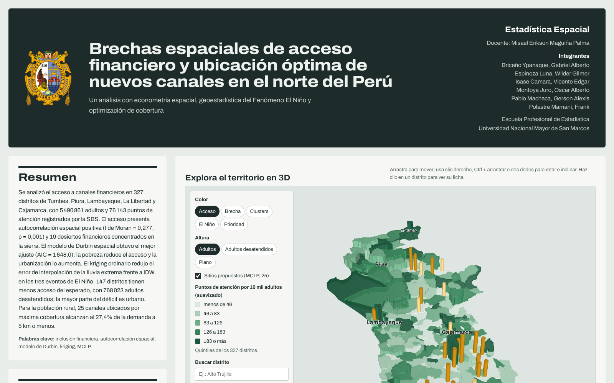
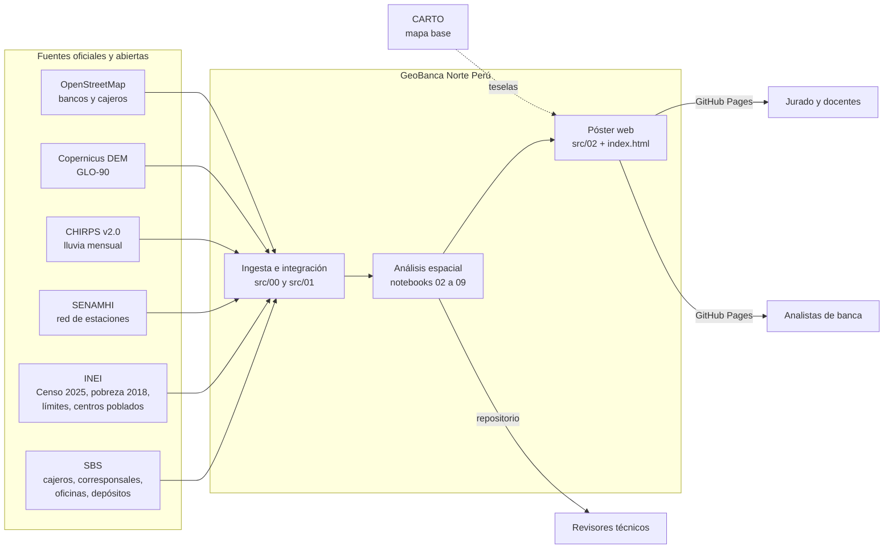
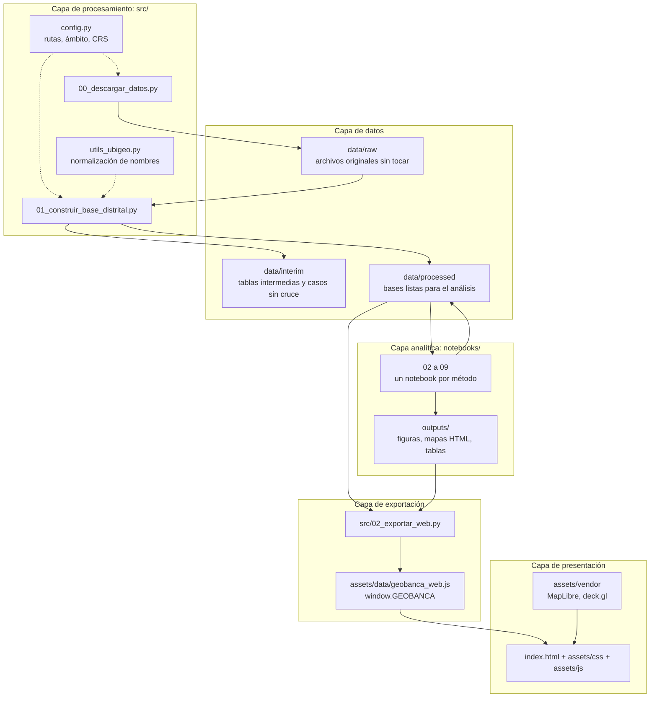
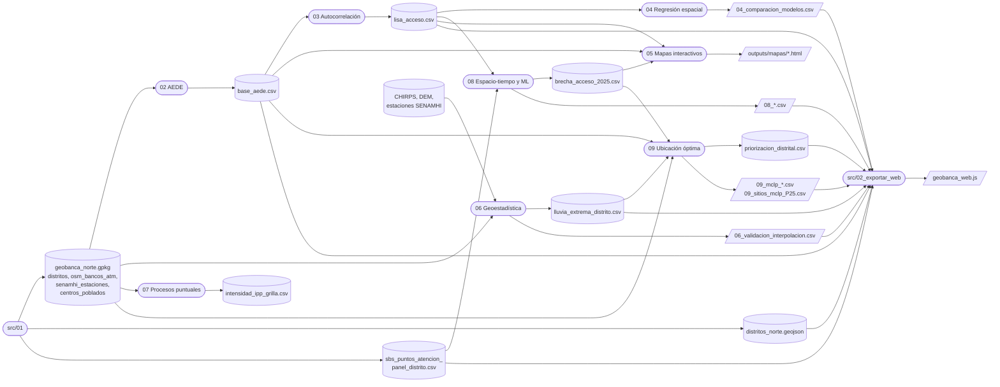
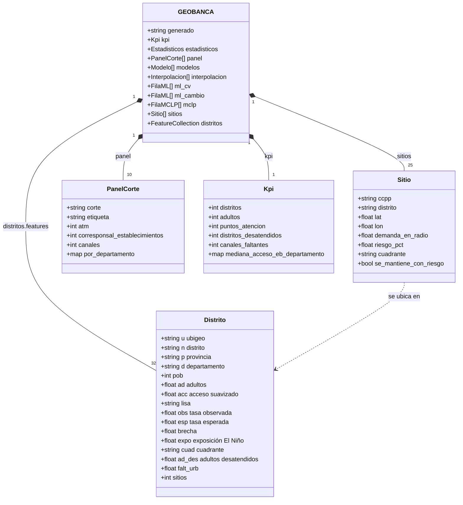
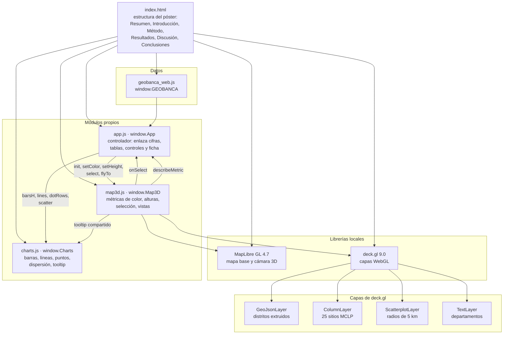
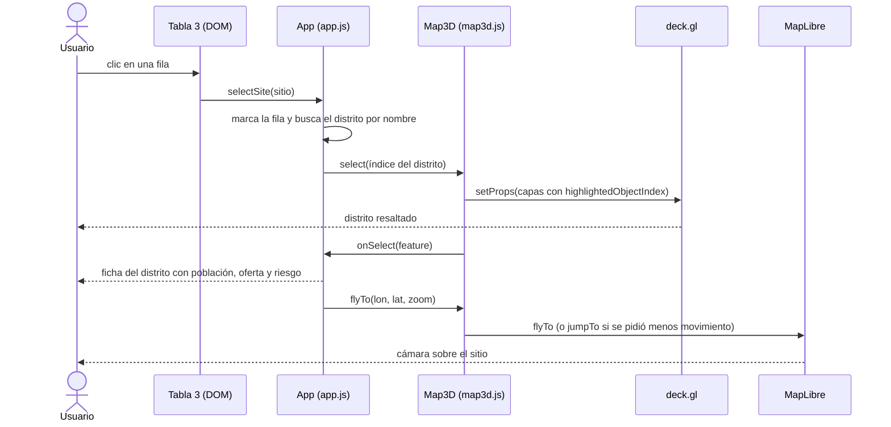
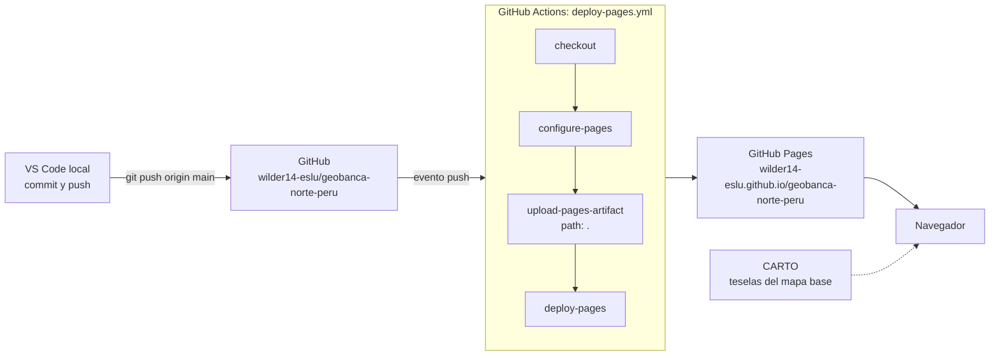
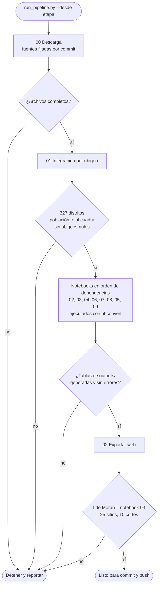

# GeoBanca Norte Perú

**Brechas espaciales de acceso financiero y ubicación óptima de nuevos canales en el norte del Perú**

Análisis de estadística espacial sobre datos oficiales del Perú (SBS, INEI, SENAMHI). Combina dependencia espacial, econometría
espacial, geoestadística de la lluvia de El Niño, procesos puntuales, aprendizaje automático con validación espacial y un modelo
de máxima cobertura para decidir dónde abrir nuevos canales de atención financiera.

**Póster interactivo:** https://wilder14-eslu.github.io/geobanca-norte-peru/



---

## Pregunta

Si una entidad financiera quiere abrir nuevos cajeros, agentes corresponsales u oficinas especiales en la Macro Región Norte
(Tumbes, Piura, Lambayeque, La Libertad y Cajamarca), ¿dónde debería hacerlo?

1. **Oportunidad:** ¿qué distritos tienen menos acceso del que les corresponde?
2. **Explicación:** ¿qué factores sociales y espaciales explican ese acceso?
3. **Riesgo:** ¿qué zonas están más expuestas a la lluvia extrema de El Niño?
4. **Decisión:** ¿dónde ubicar los nuevos canales para cubrir a más adultos desatendidos?

## Ámbito y datos

| Unidad | Valor |
|---|---|
| Distritos | 327 |
| Población 2025 | 7 323 726 |
| Adultos (18 años o más, estimados) | 5 490 861 |
| Puntos de atención (marzo 2026) | 76 143: 4 941 cajeros, 70 560 agentes corresponsales, 629 oficinas y 13 EOB |
| Panel SBS | 10 cortes, de diciembre de 2017 a marzo de 2026 |
| Centros poblados georreferenciados | 14 481 |
| Estaciones meteorológicas SENAMHI | 175 |

Fuentes: SBS (Boletín Estadístico), INEI (Censo 2025, Mapa de Pobreza 2018, límites, ubigeos y centros poblados), SENAMHI,
CHIRPS v2.0, Copernicus DEM GLO-90 y OpenStreetMap. Detalle, licencias y advertencias en
[`docs/catalogo_datos.md`](docs/catalogo_datos.md).

## Resultados principales

Todas las cifras provienen de los notebooks y de las tablas de `outputs/tablas/`.

**1. Hay oferta, pero mal repartida** (notebooks 02 y 03)
- El ámbito tiene 138,7 puntos de atención por 10 mil adultos, pero la mediana distrital es 102. 237 distritos no tienen
  cajero automático, 197 no tienen oficina y 5 no tienen ningún canal.
- El acceso está espacialmente agrupado: I de Moran = 0,277 (p = 0,001) y C de Geary = 0,72, con el mismo resultado en cuatro
  matrices de pesos. Hay 34 distritos Alto-Alto en la costa de Piura y Tumbes y 19 desiertos financieros Bajo-Bajo
  (212 mil habitantes), casi todos en la sierra de Cajamarca y de Piura.

**2. Pobreza, urbanización y entorno explican el acceso** (notebook 04)

| Modelo | AIC | Pseudo R² | I de Moran de residuos | Parámetro espacial |
|---|---:|---:|---:|---:|
| OLS | 1695,6 | 0,233 | 0,214 | |
| SAR | 1680,3 | 0,286 | 0,045 | ρ = 0,298 |
| SEM | 1661,7 | 0,231 | -0,016 | λ = 0,452 |
| SDM | 1648,0 | 0,384 | 0,001 | ρ = 0,427 |

- Las pruebas LM robustas favorecen el error espacial (LM-error 31,4 frente a LM-rezago 15,3). El SDM logra el menor AIC y la
  prueba de factor común rechaza reducirlo al SEM (p = 0,0004).
- En todas las especificaciones la pobreza reduce el acceso y la urbanización lo aumenta (p < 0,05). La urbanización tiene un
  derrame negativo: una ciudad grande concentra la oferta en desmedro de sus distritos vecinos.

**3. Dónde golpea El Niño** (notebook 06)
- La lluvia de marzo de 1998 tiene un semivariograma gaussiano con rango práctico de 147 km y anisotropía costa-sierra.
- El kriging ordinario reduce el RMSE de validación cruzada frente a IDW en los tres eventos:

  | Evento | IDW | Kriging ordinario | Kriging con deriva (altitud) |
  |---|---:|---:|---:|
  | Marzo 1998 | 94,7 mm | 72,5 mm | 74,8 mm |
  | Marzo 2017 | 136,9 mm | 95,3 mm | 98,6 mm |
  | Marzo 2023 | 111,1 mm | 94,1 mm | 94,9 mm |

- Los distritos más expuestos están en Tumbes (Matapalo, Pampas de Hospital, Casitas, Papayal) y en la sierra de Piura
  (Lancones, Suyo).

**4. La oferta se apila en los mismos lugares** (notebook 07)
- En Trujillo metropolitano (92 sitios), Clark-Evans R = 0,41 (z = -10,9): la distancia media al vecino más cercano es 224 m
  frente a 552 m bajo aleatoriedad completa. Alto Trujillo y Florencia de Mora casi no tienen oferta.
- En toda la región, la K no homogénea supera la envolvente entre 0,5 y 2,8 km: hay agrupamiento que la demanda no explica.

**5. La red creció sin reducir la segregación** (notebook 08)
- Los canales pasaron de 22 729 (diciembre de 2017) a 87 820 (diciembre de 2023) y bajaron a 73 319 (diciembre de 2025).
  La caída de 2024 ocurre en los cinco departamentos a la vez.
- El I de Moran anual se mantiene entre 0,20 y 0,24. En la cadena de Markov espacial, un distrito del segundo quintil sube con
  probabilidad 0,36 si sus vecinos están en el quintil más alto y 0,12 si están en el segundo; el quintil más bajo es el más
  persistente (0,79).
- Con validación cruzada espacial por provincias, el Random Forest con rezagos espaciales y posición alcanza R² = 0,33.
  El cambio anual de cada distrito no es predecible: ningún modelo supera a la persistencia (RMSE 0,559 frente a 0,560).

**6. Dos déficits distintos y dónde abrir** (notebook 09)
- 147 distritos tienen menos acceso del esperado por su estructura. Cerrar la brecha requiere unos 9 466 canales y alcanza a
  768 023 adultos desatendidos.
- La mayor parte del déficit es urbano (7 777 canales). Siete distritos (Veintiséis de Octubre, Pariñas, Castilla,
  Alto Trujillo, Chulucanas, Paita y Tambo Grande) explican el 55% del total: en la ciudad falta capacidad, no cercanía.
- Para los 232 136 adultos rurales desatendidos, el MCLP resuelto de forma exacta con CBC cubre a 5 km o menos:

  | Canales nuevos | Cobertura exacta | Heurística voraz |
  |---:|---:|---:|
  | 10 | 14,1% | 14,1% |
  | 25 | 27,4% | 27,4% |
  | 50 | 42,7% | 41,9% |

- Al descontar la demanda por riesgo climático, 18 de los 25 sitios se repiten y la cobertura apenas baja de 27,4% a 27,0%.
  El riesgo cambia el tipo de canal (físico o resiliente) más que su ubicación.

## Limitaciones

- La SBS reporta los corresponsales por entidad: un mismo comercio puede contarse más de una vez.
- La población adulta distrital es estimada, porque el INEI no publica edad por distrito.
- La pobreza distrital más reciente es de 2018, siete años antes del Censo 2025.
- La demanda rural se reparte en partes iguales entre los caseríos de cada distrito, porque la base no trae población por
  centro poblado.
- La distancia del MCLP es en línea recta, no por red vial.
- El acceso esperado proviene de un modelo con R² cercano a 0,33, así que la brecha de cada distrito tiene incertidumbre.
- El índice climático mide lluvia extrema, no huaicos ni cortes de vía.

## Notebooks

| Notebook | Etapa | Métodos |
|---|---|---|
| [`02_aede`](notebooks/02_aede.ipynb) | Análisis exploratorio | Bayes empírico, boxmap, centrografía |
| [`03_pesos_autocorrelacion`](notebooks/03_pesos_autocorrelacion.ipynb) | Dependencia espacial | Matrices de pesos, Moran, Geary, LISA, Gi*, Moran bivariado |
| [`04_regresion_espacial`](notebooks/04_regresion_espacial.ipynb) | Modelos de áreas | OLS y pruebas LM, SAR, SEM (ML y GMM), SDM e impactos |
| [`05_mapas_interactivos`](notebooks/05_mapas_interactivos.ipynb) | Comunicación | Mapas folium con capas y fichas por distrito |
| [`06_geoestadistica_precipitacion`](notebooks/06_geoestadistica_precipitacion.ipynb) | Geoestadística | Semivariograma, anisotropía, IDW, kriging ordinario y con deriva externa |
| [`07_patrones_puntuales`](notebooks/07_patrones_puntuales.ipynb) | Procesos puntuales | Cuadrantes, Clark-Evans, G, F, K y L, kernel, Poisson no homogéneo |
| [`08_espaciotemporal_ml`](notebooks/08_espaciotemporal_ml.ipynb) | Espacio-tiempo y ML | Markov espacial, origen móvil, Ridge, Random Forest, XGBoost, SHAP |
| [`09_ubicacion_optima`](notebooks/09_ubicacion_optima.ipynb) | Decisión | Matriz oportunidad por riesgo, MCLP exacto y voraz, sensibilidad |

## Estructura

```
geobanca-norte-peru/
├── index.html                 póster web interactivo (GitHub Pages)
├── assets/
│   ├── css/  js/              estilos, mapa 3D (MapLibre + deck.gl) y gráficos
│   ├── data/geobanca_web.js   datos del póster, generados por src/02_exportar_web.py
│   ├── img/  fonts/  vendor/  escudo, tipografía Archivo y librerías locales
├── data/
│   ├── raw/                   fuentes originales (se descargan con src/00_descargar_datos.py)
│   ├── interim/               tablas intermedias y casos sin cruce de ubigeo
│   └── processed/             bases listas para el análisis
├── notebooks/                 un notebook por etapa del análisis
├── src/
│   ├── config.py              rutas, ámbito y sistemas de referencia
│   ├── utils_ubigeo.py        normalización de nombres y asignación de ubigeo
│   ├── 00_descargar_datos.py  descarga reproducible de las fuentes
│   ├── 01_construir_base_distrital.py  integración por ubigeo y capas espaciales
│   └── 02_exportar_web.py     exporta los resultados de los notebooks al póster
├── outputs/                   figuras, mapas HTML y tablas
└── docs/                      catálogo de datos, guía SENAMHI e imágenes
```

## Arquitectura

Cómo está construido el proyecto: de dónde vienen los datos, cómo fluyen entre los scripts y los notebooks, cómo funciona el póster web y cómo se publica.

### Contexto del sistema

Quién entrega datos al sistema y quién consume sus resultados.



### Arquitectura por capas

Cada capa solo lee de la capa anterior. Así un cambio en una fuente no obliga a tocar el póster.



### Flujo de datos entre etapas

Qué archivo produce cada etapa y quién lo consume. Es el grafo real de dependencias, extraído del código de los notebooks.



Orden de ejecución que respeta las dependencias: `01 → 02 → 03 → 04 → 06 → 07 → 08 → 05 → 09 → exportar_web`.
El notebook 05 va después del 08 porque usa la brecha de acceso que el 08 calcula.

### Modelo de datos del póster

Estructura de `window.GEOBANCA`, el único archivo de datos que lee la web. Los nombres de propiedad de cada distrito son cortos
para que el archivo pese menos (442 KB con las 327 geometrías simplificadas).



### Componentes del frontend

La web es estática: no hay servidor ni base de datos. Cada módulo de JavaScript expone un objeto global con una sola
responsabilidad, y `app.js` los coordina.



### Interacción en el póster

Qué pasa cuando alguien selecciona un sitio en la Tabla 3. El clic en un distrito del mapa sigue el mismo camino desde
`Map3D.select`.



### Despliegue

El póster se publica solo en cada push a `main`. GitHub Actions sube el repositorio como sitio estático.



Todo lo que necesita el póster (datos, librerías, tipografía, escudo) va dentro del repositorio. Si falla internet durante
una exposición, el póster abre igual desde la carpeta local; solo falta el mapa base de fondo.

### Pipeline orquestado (propuesta)

Hoy cada etapa se ejecuta a mano. Esta es la propuesta para un `run_pipeline.py` que ejecute todo en orden, valide la salida
de cada etapa y se detenga ante el primer error, para que un dato roto nunca llegue al póster. **Todavía no está implementado.**



### Decisiones de diseño

| Decisión | Alternativa descartada | Motivo |
|---|---|---|
| Sitio estático en GitHub Pages | Servidor con API (Flask, Node) | No hay datos sensibles ni consultas en vivo; un sitio estático no se cae ni cuesta. |
| Cifras generadas por `02_exportar_web.py` | Escribirlas a mano en el HTML | Una sola fuente de verdad: si cambia un notebook, la web se actualiza sin errores de copia. |
| Librerías y tipografía dentro del repo | Cargarlas desde un CDN | El póster funciona sin internet durante la exposición. |
| MapLibre + deck.gl | Leaflet o folium | Extrusión 3D por WebGL, cámara con inclinación y rotación, y miles de polígonos fluidos. |
| Geometrías simplificadas a 350 m | GeoJSON completo (7,6 MB) | 442 KB en total; a escala regional la diferencia no se ve. |
| Dos sistemas de referencia | Uno solo | EPSG:4326 para intercambio y web; EPSG:32717 (UTM 17S) para distancias, áreas, kriging y el MCLP. |
| Ubigeo INEI de 6 dígitos como llave | Unir por nombre de distrito | Los nombres cambian de escritura entre fuentes; el ubigeo no. `utils_ubigeo.py` resuelve los casos que solo traen nombre. |
| Un notebook por método | Un solo notebook largo | Cada etapa se revisa, corrige y vuelve a ejecutar sin rehacer todo. |

## Cómo reproducir

```bash
git clone https://github.com/wilder14-eslu/geobanca-norte-peru.git
cd geobanca-norte-peru
python -m venv .venv
.venv\Scripts\activate                     # Linux o macOS: source .venv/bin/activate
pip install -r requirements.txt

python src/00_descargar_datos.py            # fuentes base a data/raw
python src/00_descargar_datos.py --chirps --dem   # lluvia y elevación, necesarias para el notebook 06
python src/01_construir_base_distrital.py   # base distrital y GeoPackage en data/processed
```

Luego se ejecutan los notebooks en orden (02 a 09). El MCLP del notebook 09 usa el solver CBC que se instala con `pulp`.

Para actualizar el póster con los resultados nuevos:

```bash
python src/02_exportar_web.py               # regenera assets/data/geobanca_web.js
python -m http.server 8000                  # abrir http://localhost:8000
```

El póster no tiene cifras escritas a mano: todas se leen de `data/processed/` y `outputs/tablas/`. Las librerías y la tipografía
están dentro del repositorio, así que funciona sin internet; solo el mapa base de fondo necesita conexión.

## Notas sobre los datos

- Las fuentes de GitHub están fijadas a un commit, así que la descarga obtiene los mismos archivos usados aquí.
- OpenStreetMap es una foto al 16/10/2026; `--osm-actualizar` vuelve a consultarlo y los conteos pueden cambiar.
- Los registros diarios de SENAMHI requieren registro por estación. El notebook 06 usa CHIRPS como campo de referencia y las
  coordenadas reales de la red SENAMHI como diseño de muestreo (ver [`docs/guia_senamhi.md`](docs/guia_senamhi.md)).
- La verificación del cruce por ubigeo está en `outputs/tablas/reporte_verificacion.txt`.

## Autores

Briceño Ypanaque, Gabriel Alberto · Espinoza Luna, Wilder Gilmer · Isase Camara, Vicente Edgar · Montoya Juro, Oscar Alberto ·
Pablo Machaca, Gerson Alexis · Polastre Mamani, Frank

Escuela Profesional de Estadística, Universidad Nacional Mayor de San Marcos.

Los datos conservan las licencias de sus fuentes originales; ver [`docs/catalogo_datos.md`](docs/catalogo_datos.md).
