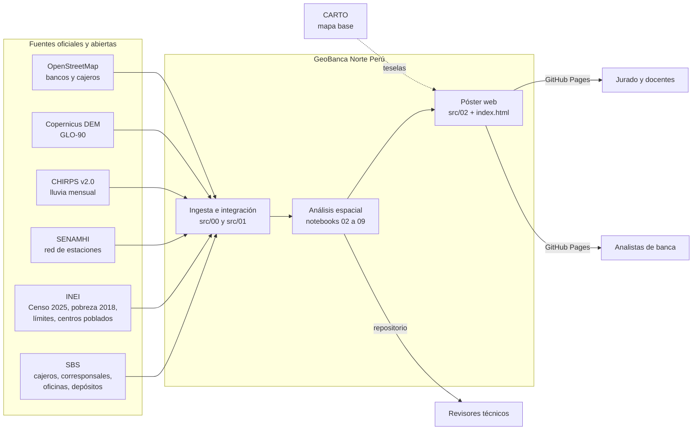
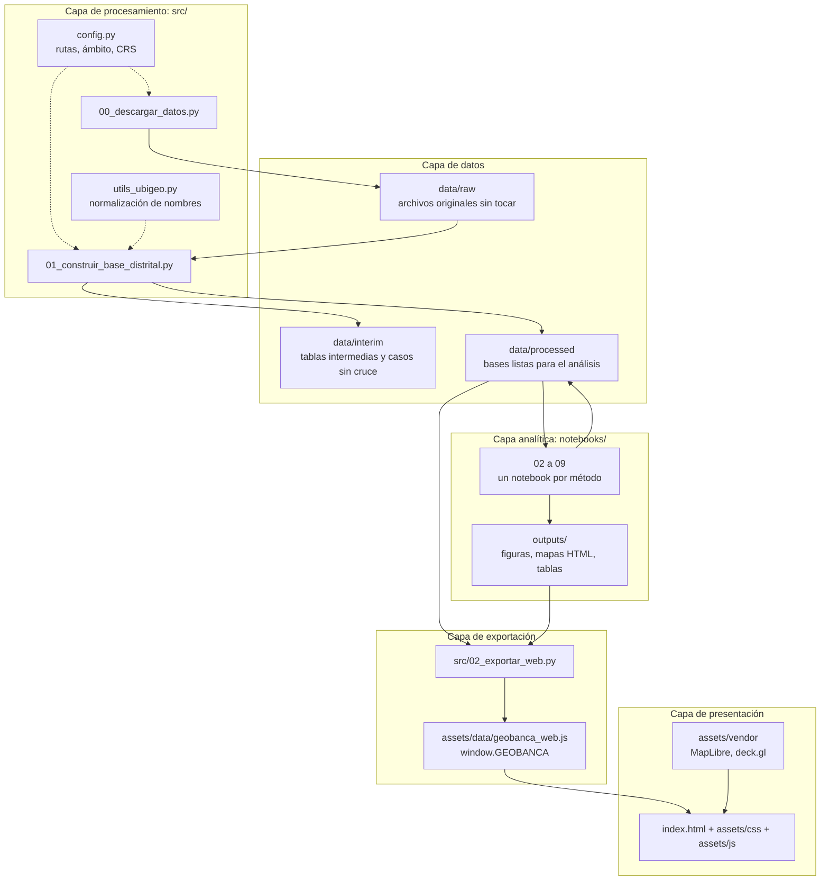
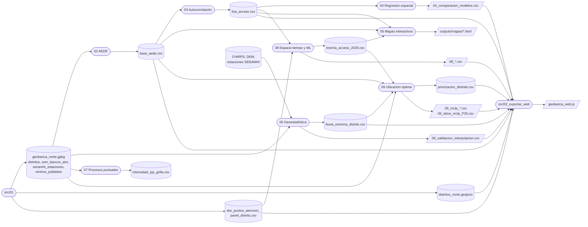
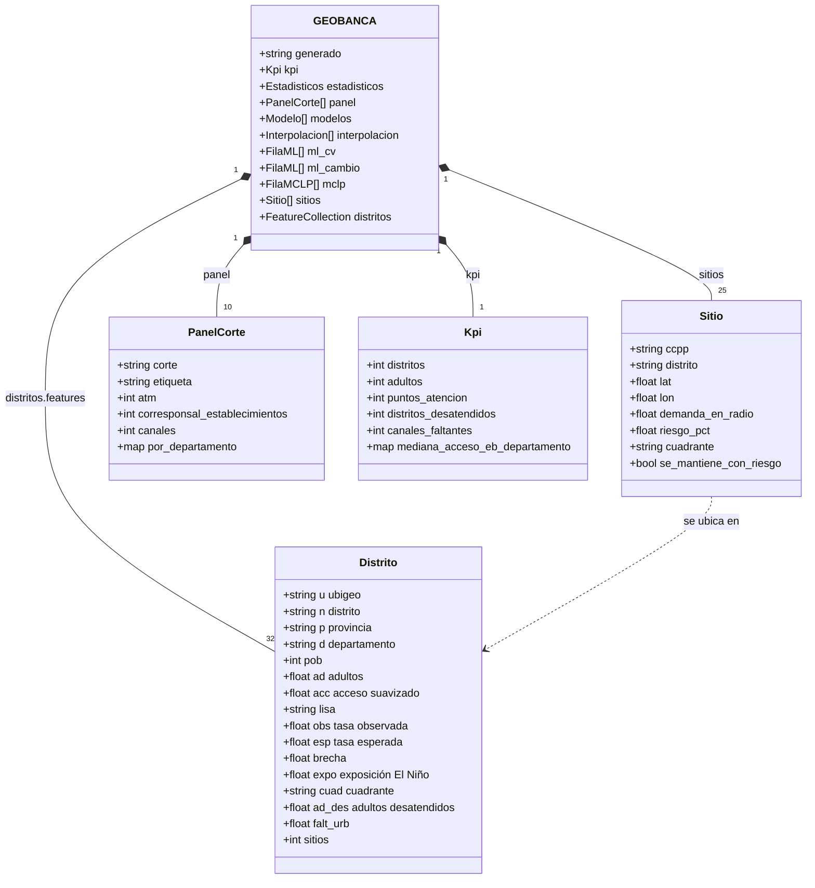
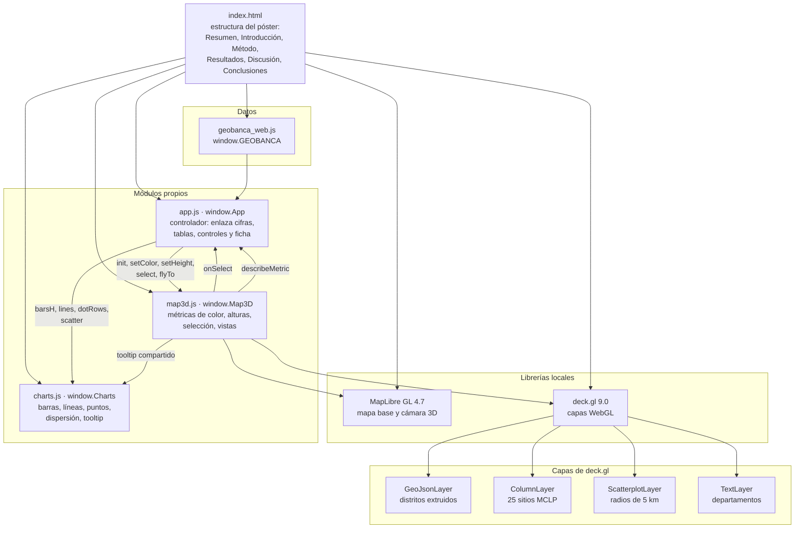
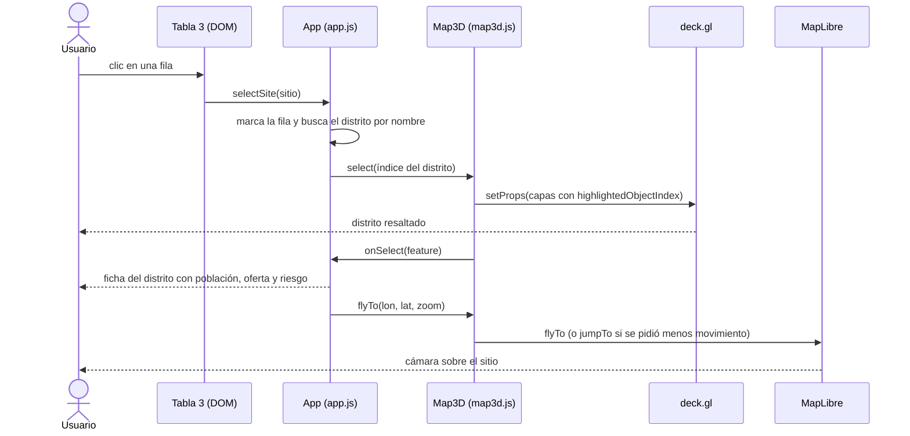
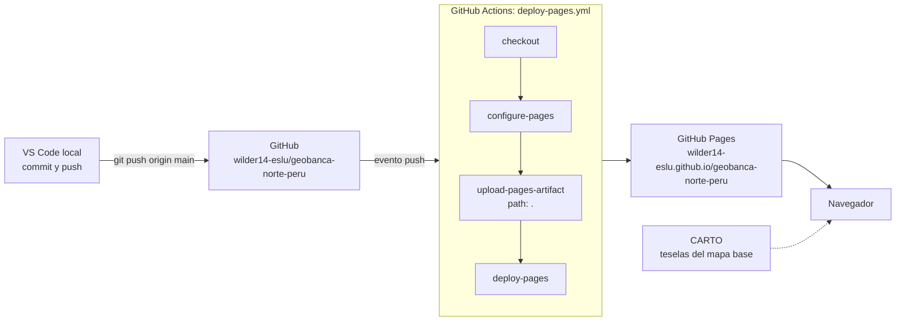
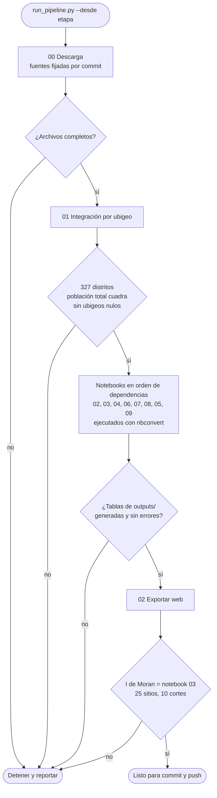

# Arquitectura de GeoBanca Norte Perú

Este documento explica cómo está construido el proyecto: de dónde vienen los datos, cómo fluyen entre los scripts y los
notebooks, cómo funciona el póster web y cómo se publica. Los diagramas usan Mermaid y GitHub los muestra como imágenes.

1. [Contexto del sistema](#1-contexto-del-sistema)
2. [Arquitectura por capas](#2-arquitectura-por-capas)
3. [Flujo de datos entre etapas](#3-flujo-de-datos-entre-etapas)
4. [Modelo de datos del póster](#4-modelo-de-datos-del-póster)
5. [Componentes del frontend](#5-componentes-del-frontend)
6. [Interacción en el póster](#6-interacción-en-el-póster)
7. [Despliegue](#7-despliegue)
8. [Pipeline orquestado (propuesta)](#8-pipeline-orquestado-propuesta)
9. [Decisiones de diseño](#9-decisiones-de-diseño)

---

## 1. Contexto del sistema

Quién entrega datos al sistema y quién consume sus resultados.

## 2. Arquitectura por capas

Cada capa solo lee de la capa anterior. Así un cambio en una fuente no obliga a tocar el póster.

## 3. Flujo de datos entre etapas

Qué archivo produce cada etapa y quién lo consume. Es el grafo real de dependencias, extraído del código de los notebooks.

Orden de ejecución que respeta las dependencias: `01 → 02 → 03 → 04 → 06 → 07 → 08 → 05 → 09 → exportar_web`.
El notebook 05 va después del 08 porque usa la brecha de acceso que el 08 calcula.

## 4. Modelo de datos del póster

Estructura de `window.GEOBANCA`, el único archivo de datos que lee la web. Los nombres de propiedad de cada distrito son cortos
para que el archivo pese menos (442 KB con las 327 geometrías simplificadas).

## 5. Componentes del frontend

La web es estática: no hay servidor ni base de datos. Cada módulo de JavaScript expone un objeto global con una sola
responsabilidad, y `app.js` los coordina.

## 6. Interacción en el póster

Qué pasa cuando alguien selecciona un sitio en la Tabla 3. El clic en un distrito del mapa sigue el mismo camino desde
`Map3D.select`.

## 7. Despliegue

El póster se publica solo en cada push a `main`. GitHub Actions sube el repositorio como sitio estático.

Todo lo que necesita el póster (datos, librerías, tipografía, escudo) va dentro del repositorio. Si falla internet durante
una exposición, el póster abre igual desde la carpeta local; solo falta el mapa base de fondo.

## 8. Pipeline orquestado (propuesta)

Hoy cada etapa se ejecuta a mano. Esta es la propuesta para un `run_pipeline.py` que ejecute todo en orden, valide la salida
de cada etapa y se detenga ante el primer error, para que un dato roto nunca llegue al póster. **Todavía no está implementado.**

## 9. Decisiones de diseño

| Decisión | Alternativa descartada | Motivo |
|---|---|---|
| Sitio estático en GitHub Pages | Servidor con API (Flask, Node) | No hay datos sensibles ni consultas en vivo; un sitio estático no se cae ni cuesta. |
| Cifras generadas por `02_exportar_web.py` | Escribirlas a mano en el HTML | Una sola fuente de verdad: si cambia un notebook, la web se actualiza sin errores de copia. |
| Librerías y tipografía dentro del repo | Cargarlas desde un CDN | El póster funciona sin internet durante la exposición. |
| MapLibre + deck.gl | Leaflet o folium | Extrusión 3D por WebGL, cámara con inclinación y rotación, y miles de polígonos fluidos. |
| Geometrías simplificadas a 350 m | GeoJSON completo (7,6 MB) | 442 KB en total; a escala regional la diferencia no se ve. |
| Dos sistemas de referencia | Uno solo | EPSG:4326 para intercambio y web; EPSG:32717 (UTM 17S) para distancias, áreas, kriging y el MCLP. |
| Ubigeo INEI de 6 dígitos como llave | Unir por nombre de distrito | Los nombres cambian de escritura entre fuentes; el ubigeo no. `utils_ubigeo.py` resuelve los casos que solo traen nombre. |
| Un notebook por método | Un solo notebook largo | Cada etapa se revisa, corrige y vuelve a ejecutar sin rehacer todo. |
