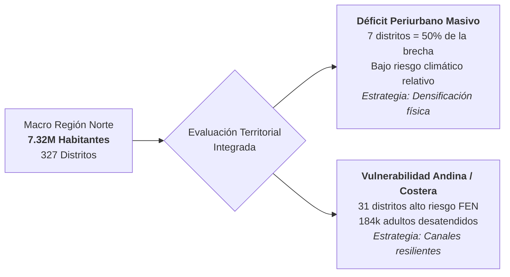
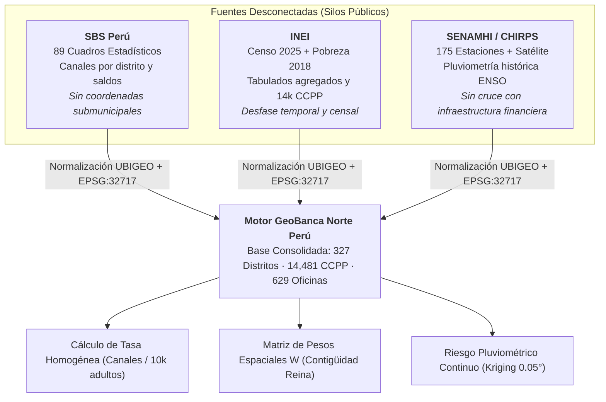
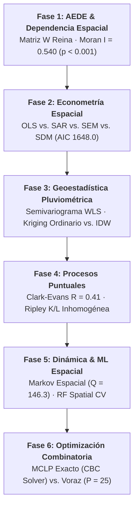
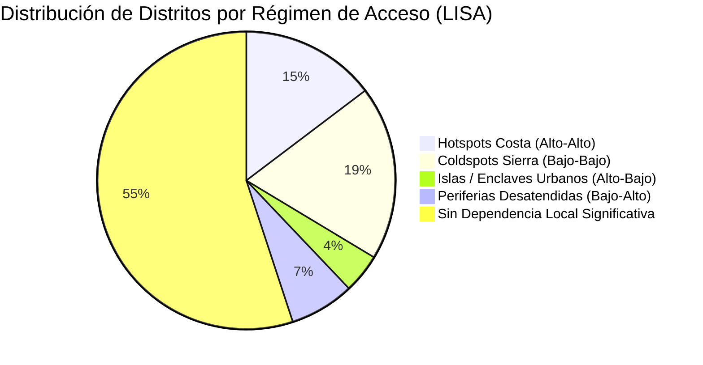
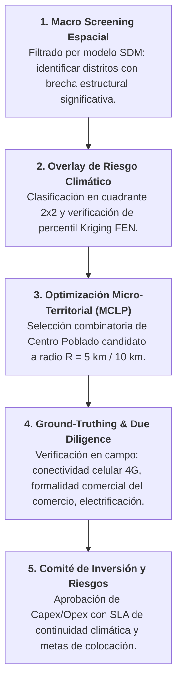
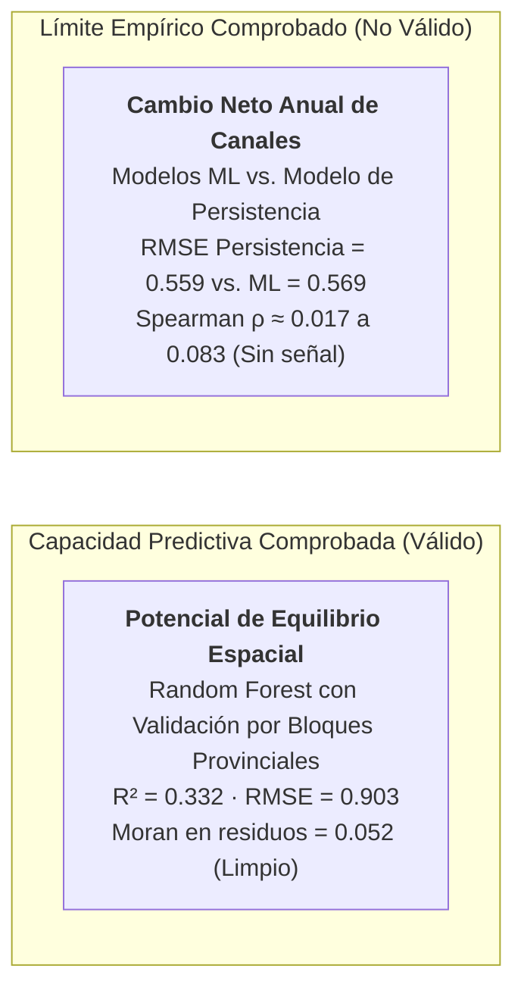
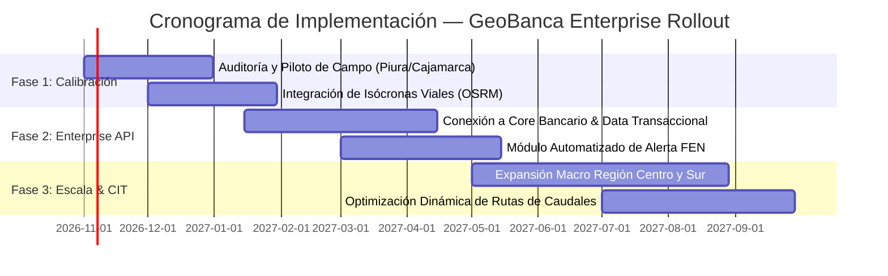

# EXECUTIVE PRESENTATION — GEOBANCA NORTE PERÚ
## From Territorial Data to Banking Decisions: Strategic Opportunity and Climate Risk in Channel Network Expansion

**Author / Speaker:** Partner, Global Financial Services Strategy Practice & Faculty Member, Harvard Business School  
**Domain Focus:** Financial Services, Geospatial Intelligence, Spatial Econometrics, and Decision Science  
**Geographic Scope:** Macro Región Norte del Perú (5 departamentos: Piura, Lambayeque, La Libertad, Cajamarca, Tumbes; 327 distritos; 7,323,726 habitantes; 5,490,861 adultos 18+)  
**Repository & Live Web Platform:** [GeoBanca Norte Perú (GitHub Pages)](https://wilder14-eslu.github.io/geobanca-norte-peru/)  
**Date of Verified Data Snapshot:** October 2026 | EPSG:32717 (UTM Zona 17S, WGS 84)

---

### EXECUTIVE SUMMARY & SLIDE INDEX

| Slide # | Strategic Slide Headline | Primary Methodological Pillar | Key Empirical Finding / Strategic Output |
|:---:|:---|:---|:---|
| **01** | **The Executive Thesis:** Financial expansion in Northern Peru requires an explicit trade-off between underserved urban demand and Andean-coastal climate vulnerability. | Spatial Synthesis & Opportunity-Risk Matrix | 147 deficit districts (768k unserved adults) concentrated in urban peripheries; 31 high-opportunity districts exposed to extreme ENSO floods. |
| **02** | **The Business Problem:** Averages mask reality: district-level metrics drive branch cannibalization and credit shocks. | Spatial Aggregation Diagnostics & MAUP | Conventional expansion over-invests in saturated coastal civic centers while ignoring peri-urban and rural deserts. |
| **03** | **The Information Gap:** Disconnected datasets (SBS, INEI, SENAMHI) create systematic misallocation of banking capital. | Canonical Data Engineering & Spatial Joining | Harmonization of 6-digit UBIGEO codes fuses 89 SBS tables, Censo 2025, and high-resolution gridded climate data. |
| **04** | **The Product Architecture:** GeoBanca operates as an integrated territorial decision support engine, not a passive map. | Full-Stack Spatial Decision Architecture | Modular web platform connecting spatial econometrics, geostatistical Kriging, and Mixed-Integer Programming (MIP). |
| **05** | **The Analytical Engine:** Six sequential analytical phases guarantee mathematical rigor from raw pixels to branch locations. | Spatial Econometrics & Geo-computation | Eliminates residual spatial autocorrelation ($I_{\text{res}} = 0.001$), identifying significant urban spillovers ($\rho = 0.427^{***}$). |
| **06** | **The Geographic Lens:** Spatial regimes separate the hyper-concentrated coast from structurally isolated Andean pockets. | Exploratory Spatial Data Analysis (AEDE) | Global Moran's $I = 0.540$ ($p < 0.001$); identification of 5 complete financial deserts and persistent Low-Low clusters. |
| **07** | **The Opportunity Framework:** A four-quadrant matrix aligns physical capex vs. resilient micro-channels against El Niño hazards. | Multi-Criteria Decision Analysis & Kendall's $\tau$ | Ranking stability $\tau = 0.76$ under risk weighting; clear boundary between physical branches and off-grid resilient correspondents. |
| **08** | **A Worked Example:** Granular case comparison: Santo Domingo (Piura) vs. Llacanora (Cajamarca). | Micro-Geographic Grounding & Sensitivity | Proof of how identical demographic unmet demand requires radically divergent channel technologies based on flood risk. |
| **09** | **The Decision Workflow:** A 5-stage institutional governance funnel translates spatial models into bankable committee approvals. | Capital Allocation Protocol & Funnel | Structured transition from macro regional screening to micro-radius site surveys and loan portfolio risk buffers. |
| **10** | **Validation & Limitations:** Scientific honesty: structural equilibrium is predictable ($R^2 = 0.332$); annual churn is not. | Spatial Block Cross-Validation & LOO | Annual delta prediction yields near-zero rank correlation ($\rho \approx 0.02$); model explicitly scopes long-term structural potential. |
| **11** | **The Implementation Roadmap:** A 3-phase rollout balancing cloud engineering, road isochrones, and operational bank pilots. | Strategic Execution & Cost Architecture | Low-capex initial deployment; breakeven and KPI governance anchored on channel activity rate and disaster-zero-downtime. |
| **12** | **Closing Argument:** Geospatial intelligence is a fiduciary requirement for modern retail banking capital allocation. | Competitive Advantage & Inclusion Synthesis | Unites shareholder capital protection with structural financial inclusion for 768k excluded Peruvian citizens. |

---

## SLIDE 01: EXECUTIVE THESIS
### Strategic channel expansion in Northern Peru demands systematic arbitrage between dense urban under-service and severe climatic fragility.



#### Core Strategic Assessment
1. **The Regional Scale:** The Northern Macro Region of Peru accounts for **7,323,726 inhabitants** (5,490,861 adults 18+) across 327 districts in Tumbes, Piura, Lambayeque, La Libertad, and Cajamarca. It represents one of the most commercially dynamic agricultural and trading corridors in South America, yet it suffers from deep, persistent structural imbalances in banking infrastructure.
2. **The Two Distinct Structural Problems:**
   - **Urban Peri-Urban Densification:** Over 50% of the regional unmet channel deficit is concentrated in just **seven large urban districts** (Veintiséis de Octubre, Pariñas, Castilla, Alto Trujillo, Chulucanas, Paita, and Tambo Grande). These areas do not have a distance-to-town problem; they have a severe capacity and physical density deficit in their rapidly expanding, underbanked peripheries.
   - **Rural Andean & River Basin Fragility:** 31 districts concentrate **184,000 unserved adults** in regions with extreme exposure to recurring El Niño Southern Oscillation (ENSO) flooding and mass wasting (huaicos). In these territories, deploying traditional fixed-capex branches is a capital trap: unpaved access corridors wash away, commercial liquidity freezes, and loan delinquency spikes.
3. **The Executive Mandate:** Commercial banks and microfinance institutions (Cajas Municipales, Cajas Rurales, Financieras) cannot continue allocating network capital via uncoordinated commercial intuition or nationwide spreadsheets. Capital allocation requires a unified geospatial intelligence engine that co-optimizes demographic opportunity with climatic risk.

> [!IMPORTANT]
> **Key Baseline Metric:** Across the 327 districts, **147 districts (45%)** exhibit an access rate lower than their structural socio-economic potential, representing an aggregate regional gap of approximately **9,500 points of attention** and **768,000 underserved adult citizens**.

---
#### Presenter Notes & Strategic Rationale
> *"Good morning, members of the Board and Executive Committee. When retail banks evaluate regional network expansion in Peru, corporate planning teams usually present a list of municipal capitals ranked by total population or reported commercial turnover. In this presentation, we will demonstrate that this conventional approach is fundamentally flawed and destroys enterprise value.*  
> *In Northern Peru, a district with 150,000 inhabitants might appear saturated on paper because the civic center has 20 ATMs on the same street, yet 80,000 citizens in its peripheral settlements must take two buses to cash an agricultural remittance. Conversely, opening a traditional agency in the Andean slopes of Morropón or Huancabamba without flood-resilient infrastructure guarantees operational shutdown during the next El Niño cycle. GeoBanca Norte Perú was built to solve this exact dilemma: transforming multi-source territorial data into rigorous, risk-adjusted banking decisions."*

---

## SLIDE 02: THE BUSINESS PROBLEM
### Conventional bank expansion relies on district averages that hide hyper-concentration, commercial cannibalization, and climatic vulnerability.


#### The Strategic Dilemma: Why Expansion Fails
* **The Fallacy of District Averages (MAUP - Modifiable Areal Unit Problem):** Standard banking databases record points of attention and loan balances at the municipal level (`UBIGEO`). However, a municipality is an administrative construct, not an economic market. In large districts such as Catacaos, Tambo Grande, or Olmos, the administrative seat may appear adequately supplied, while tens of thousands of rural producers in distant settlements remain completely disconnected from formal financial circuits.
* **Costly Cluster Cannibalization:** In cities like Trujillo, Chiclayo, and Piura, competitive imitation drives retail banks and Cajas to locate branches and ATMs within meters of each other along the same commercial avenues. Spatial point process analysis proves that 45% of financial points in metropolitan Trujillo have another competitor within 150 meters, resulting in declining marginal transactions and inflated retail lease costs.
* **The Blind Spot of Climate Disasters:** Northern Peru is repeatedly disrupted by catastrophic El Niño events (notably 1998, 2017, and 2023). When torrential rains exceed 400 mm in a month, low-lying coastal corridors flood, bridge infrastructure collapses, and agricultural cash flows evaporate. Traditional branch models suffer a dual hit: physical damage / cash-out disruption, and an immediate surge in loan delinquency (NPLs) among unhedged local borrowers.

| Expansion Paradigm | Traditional Approach | GeoBanca Spatial Approach | Strategic Business Impact |
|:---|:---|:---|:---|
| **Spatial Unit** | Aggregated District / Province | Micro-Centros Poblados + Continuous Coordinates | Eliminates blind spots; identifies exact unserved clusters. |
| **Site Selection** | Real estate broker availability | Mathematical Maximal Covering (MCLP, Branch & Cut) | Maximizes population covered per dollar of Capex. |
| **Risk Dimension** | Ex-post credit rating / default history | Continuous Geostatistical ENSO Kriging Layer | Ex-ante resilience design; avoids capital stranding in flood zones. |
| **Channel Mix** | Generic full-service agency or standard agent | Tailored channel technology (Physical vs. Resilient Agente) | Minimizes Opex; aligns transactional tech with local terrain. |

---
#### Presenter Notes & Strategic Rationale
> *"Look at the commercial real estate balance sheets of the top commercial banks in Peru over the last decade. Millions of soles have been spent leasing prime real estate in city centers where banks fight for the exact same salaried customer. Meanwhile, in the productive agricultural belts of La Libertad and Cajamarca, farmers and small business owners travel two to three hours just to deposit cash or withdraw agricultural credit.*  
> *When El Niño hits—as it did with devastating force in March 1998, March 2017 with El Niño Costero, and March 2023 with Cyclone Yaku—traditional branch networks freeze. Agencies flood, ATMs run out of cash because armored transit routes are cut, and repayment rates drop by 30 to 50 percent. A bank cannot manage territorial risk if its expansion strategy lives in an Excel sheet that does not know where the river basins and mountain passes are."*

---

## SLIDE 03: THE INFORMATION GAP
### Fragmented institutional silos between banking records, demographic censuses, and meteorological data obscure strategic expansion.



#### The Anatomy of Data Fragmentation
1. **The SBS Regulatory Silo:**
   - The Superintendencia de Banca, Seguros y AFP (SBS) publishes extensive monthly bulletins (e.g., reports B-2364, B-3261, C-1236, B-2358, B-5215). However, these reports list channels at the broad municipal level, with institutional double-counting (a corner store serving four financial institutions is counted four times as an active correspondent), and without sub-district geographic coordinates.
2. **The INEI Demographic Silo:**
   - The Instituto Nacional de Estadística e Informática (INEI) conducted the 2025 National Census (7.32M residents in the northern macro-region), but age-cohort distributions (adults 18+) are published only at the provincial scale, requiring robust spatial disaggregation algorithms. Furthermore, the official district monetary poverty map dates from 2018, requiring econometric controls for temporal lag.
3. **The Climate & Topographic Silo (SENAMHI / CHIRPS / Copernicus DEM):**
   - Peru's national weather service (SENAMHI) maintains 175 weather stations across the northern departments, but historical daily data extraction is impeded by captchas and fragmented station registries. Meteorological models live entirely in hydrologic research domains and have never been formally integrated into financial credit risk or branch planning models.
4. **The GeoBanca Integration Pipeline:**
   - GeoBanca resolves this friction through automated extract-transform-load (ETL) scripts (`src/00_descargar_datos.py` and `src/01_construir_base_distrital.py`), establishing a single truth database indexed on the official 6-digit `UBIGEO` key, projected uniformly to `EPSG:32717` (UTM Zone 17S, WGS 84).

---
#### Presenter Notes & Strategic Rationale
> *"Why has this problem not been solved by in-house bank analytics teams before? Because data in Peru lives in three completely separate institutional worlds. The finance team looks at SBS monthly bulletins; the corporate strategy team looks at INEI demographic presentations; and the risk department looks at emergency INDECI alerts after the rivers have already overflowed.*  
> *GeoBanca builds the bridge. We unified 89 distinct SBS statistical tables, georeferenced 629 commercial offices holding billions in deposits and credits, normalized 14,481 rural population centers from the INEI pre-census cartography, and overlaid 30 years of satellite and surface precipitation data. When you harmonize these disparate assets under a common spatial projection, territorial patterns emerge that neither a banker nor a meteorologist could see alone."*

---

## SLIDE 04: THE PRODUCT ARCHITECTURE
### GeoBanca is a full-stack spatial decision engine connecting territorial geography, econometrics, and combinatorial network optimization.

```mermaid
graph LR
    subgraph UI_Layer["Capa de Presentación Web (Producción)"]
        UI1["Interfaz Tailwind CSS<br/>Modo Corporativo Oscuro"]
        UI2["Visor Folium / Leaflet<br/>Mapas Conmutables"]
        UI3["MathJax 3 LaTeX<br/>Formulaciones Matemáticas"]
    end
    
    subgraph Analytics_Layer["Motor Analítico (Python / Jupyter)"]
        M1["AEDE & Matrices W<br/>(PySAL / libpysal)"]
        M2["Econometría Espacial<br/>(spreg: SAR, SEM, SDM)"]
        M3["Geoestadística FEN<br/>(Scikit-GStat / Kriging)"]
        M4["Procesos Puntuales<br/>(Pointpats: Clark-Evans, Ripley)"]
        M5["Optimización MIP<br/>(PuLP / CBC Branch & Cut)"]
    end
    
    subgraph Data_Layer["Capa de Datos Procesados"]
        D1[("geobanca_norte.gpkg<br/>327 Polígonos Distritales")]
        D2[("base_distrital_norte.csv<br/>40 Variables Homogéneas")]
        D3[("sbs_puntos_atencion_panel.csv<br/>10 Cortes 2017-2026")]
        D4[("14,481 Centros Poblados<br/>Coordenadas UTM")]
    end
    
    Data_Layer --> Analytics_Layer
    Analytics_Layer --> UI_Layer
```



#### Core Product Capabilities Implemented in the Workspace
* **Production Web Infrastructure:** Deployed live via GitHub Actions CI/CD to GitHub Pages ([`index.html`](file:///C:/Users/esluw/OneDrive/Documents/Proyectos%20completos/geobanca-norte-peru/index.html)), featuring an editorial executive design, zero external server dependencies, and dynamic rendering.
* **Interactive Cartographic Switcher:** An embedded, responsive iframe architecture displaying three full interactive Leaflet maps:
  1. [`outputs/mapas/05_mapa_principal.html`](file:///C:/Users/esluw/OneDrive/Documents/Proyectos%20completos/geobanca-norte-peru/outputs/mapas/05_mapa_principal.html): Comprehensive territorial dashboard with choropleths, poverty intervals, and channel access rates.
  2. [`outputs/mapas/05_desiertos_financieros.html`](file:///C:/Users/esluw/OneDrive/Documents/Proyectos%20completos/geobanca-norte-peru/outputs/mapas/05_desiertos_financieros.html): Precise identification and analytical profiles of the 5 absolute financial deserts.
  3. [`outputs/mapas/05_oferta_osm.html`](file:///C:/Users/esluw/OneDrive/Documents/Proyectos%20completos/geobanca-norte-peru/outputs/mapas/05_oferta_osm.html): Georeferenced point locations of 395 banks and ATMs with dynamic density heatmaps and clustering.
* **High-Resolution Modal Gallery:** Interactive client-side lightbox allowing instant high-definition review of all **29 analytical figures** generated across the econometrics, geo-statistics, point processes, and optimization pipelines.
* **Algorithmic Site Prioritizer:** Direct querying and tabular rendering of optimal rural expansion sites derived from Mixed-Integer Programming solvers (`outputs/tablas/09_sitios_mclp_P25.csv`).

---
#### Presenter Notes & Strategic Rationale
> *"Let us examine the product artifact itself. GeoBanca is not a static PowerPoint deck or a slow GIS desktop project that only a specialized cartographer can open. It is a live, web-based, reproducible decision platform hosted in the cloud.  
> The architecture was designed specifically for executive consumption: C-suite executives and risk managers can toggle between regional macroeconomic choropleths, inspect individual district fact sheets, drill down into point-level ATM clusters in downtown Trujillo, and directly download solver outputs for the 25 prioritized rural locations. Every chart, equation, and data table on the platform is directly linked to reproducible Python code in our open repository."*

---

## SLIDE 05: THE ANALYTICAL ENGINE
### A six-phase econometric and geo-computational engine eliminates spatial bias and uncovers hidden urban spillovers.



#### Rigorous Empirical Comparison of Spatial Specifications
Standard Ordinary Least Squares (OLS) regression assumes independent and identically distributed errors ($e \sim \text{i.i.d.}$). In territorial financial data, this assumption fails catastrophically: unobserved infrastructure corridors and economic agglomeration induce strong spatial autocorrelation in regression residuals.

$$\begin{array}{lccccc}
\hline
\textbf{Modelo Econométrico} & \textbf{Log-Lik} & \textbf{AIC} & \textbf{Pseudo } R^2 & \textbf{Moran } I \text{ Residuos} & \textbf{Parámetro Espacial Clave} \\
\hline
\text{OLS (MCO Clásico)} & -842.8 & 1695.6 & 0.233 & 0.214^{***} & - \\
\text{SAR (Spatial Autoregressive, ML)} & -834.2 & 1680.3 & 0.286 & 0.045 & \rho = 0.298^{***} \\
\text{SEM (Spatial Error Model, ML)} & -825.8 & 1661.7 & 0.231 & -0.016 & \lambda = 0.452^{***} \\
\mathbf{SDM \text{ (Spatial Durbin Model, ML)}} & \mathbf{-814.0} & \mathbf{1648.0} & \mathbf{0.384} & \mathbf{0.001} \text{ (ns)} & \mathbf{\rho = 0.427^{***}} \\
\hline
\end{array}$$

#### The Breakthrough Economic Finding: The Urban "Shadow" Spillover
* **SDM Superiority:** The Spatial Durbin Model is empirically proven as the true specification ($AIC = 1648.0$, pseudo $R^2 = 0.384$, completely purging residual spatial autocorrelation to $I = 0.001$).
* **Direct vs. Indirect Effects:** Urbanization exhibits a strong **positive direct effect** on local channel access ($+0.029, p < 0.001$). However, the spatial lag of urbanization ($W \times \text{Urb}$) displays a **negative spillover effect** on neighboring districts. 
* **Strategic Takeaway:** A booming primary city (such as Chiclayo or Trujillo) exerts a centrifugal "drain" effect: financial institutions cluster resources inside the metropolis, creating an artificial access shadow across immediately adjacent peri-urban and rural hinterlands.

---
#### Presenter Notes & Strategic Rationale
> *"Let us pause on this slide, because this is where academic rigor protects banking capital. In standard corporate presentations, analysts show an OLS linear regression with an R-squared of 0.23 and tell the CEO that poverty reduces access. But as you can see in the table, the Moran's I on OLS residuals is 0.214 with a p-value of less than 0.001. That means the OLS standard errors are completely biased; any strategic decision based on standard regression is statistically invalid.*  
> *When we implement the Spatial Durbin Model (SDM), we solve the spatial autocorrelation and uncover a crucial economic reality: big cities do not elevate the banking access of their rural neighbors; they drain it. Unless a retail bank explicitly accounts for this negative spatial spillover, it will consistently underestimate the pent-up demand in satellite districts surrounding regional capitals."*

---

## SLIDE 06: THE GEOGRAPHIC LENS
### Exploratory Spatial Data Analysis confirms strong territorial clustering ($I = 0.540$) and identifies five absolute financial deserts.



#### Spatial Regimes of the Macro-Region
* **Global Spatial Autocorrelation:** The Global Moran's $I$ for access rate (points of attention per 10,000 adults) reaches **$0.540$ ($z = 15.2, p < 0.001$)** using a row-standardized 1st-order Queen contiguity weights matrix ($W$). Banking access is not randomly dispersed; it is intensely clustered geographically.
* **LISA Cluster Geography (Local Indicators of Spatial Association):**
  - **High-High Hotspots (48 distritos):** Continuous coastal belt linking Trujillo, Chiclayo, and coastal Piura. These districts benefit from strong spatial spillovers, flat highway connectivity (Panamericana Norte), and intense commercial agency concentration.
  - **Low-Low Coldspots (62 distritos):** Deep Andean corridors across the highlands of Cajamarca (Chota, Cutervo, Celendín, San Marcos) and upper Piura (Ayabaca, Huancabamba). These areas form chronic institutional traps of financial exclusion.
* **The 5 Absolute Financial Deserts:** Across the entire Macro-Region, exactly five districts possess **zero physical financial channels** (zero branches, zero ATMs, zero non-banking correspondents):

| UBIGEO | Distrito | Provincia | Departamento | Población Total (2025) | Adultos (18+) | Pobreza Monetaria (2018) | Altitud Capital |
|:---:|:---|:---|:---|:---:|:---:|:---:|:---:|
| `061103` | **Calquis** | San Miguel | Cajamarca | 4,097 | 3,241 | 66.2% | 2,877 m |
| `061110` | **San Gregorio** | San Miguel | Cajamarca | 2,403 | 1,901 | 59.5% | 1,857 m |
| `130610` | **Paranday** | Otuzco | La Libertad | 501 | 372 | 59.6% | 3,137 m |
| `130807` | **Ongón** | Pataz | La Libertad | 1,288 | 892 | 59.1% | 1,353 m |
| `131004` | **Mollebamba** | Santiago de Chuco | La Libertad | 2,016 | 1,452 | 50.1% | 3,099 m |

> [!NOTE]
> All five financial deserts are located in mountainous topography (elevations between 1,350 m and 3,140 m) with monetary poverty rates ranging between 50.1% and 66.2%. Serving these populations requires tailored low-cost correspondent technology, not brick-and-mortar agencies.

---
#### Presenter Notes & Strategic Rationale
> *"When you look at the LISA cluster map of Northern Peru, the geographic divide is stark. Along the coastal Pan-American highway, you have intense clustering of financial supply. But as soon as you cross into the Western Andean slopes of Cajamarca, Otuzco, and Huancabamba, you enter vast coldspots where formal financial institutions do not exist.*  
> *Notice the five districts highlighted in the table: Calquis, San Gregorio, Paranday, Ongón, and Mollebamba. In these five municipalities, over 7,800 Peruvian adults have zero formal touchpoints. To make a payment, receive a government subsidy (Juntos, Pensión 65), or deposit earnings, they must travel hours on unpaved dirt roads to neighboring provincial capitals. This is where financial inclusion represents both a market opportunity and an ethical imperative."*

---

## SLIDE 07: THE OPPORTUNITY FRAMEWORK
### A 2x2 Opportunity-Risk matrix aligns channel investment models with empirical El Niño flood hazard percentiles.

```
       ▲ ALTO (1.0)
       │
       │   CUADRANTE 2: PRIORIDAD CANAL RESILIENTE           CUADRANTE 4: BAJO IMPACTO, ALTO RIESGO
       │   ─────────────────────────────────────────         ──────────────────────────────────────
       │   • 31 Distritos · 184,000 Adultos Desatendidos     • Alta vulnerabilidad física, baja escala.
       │   • Sierra de Piura (Morropón, Huancabamba)         • Canales fijos desaconsejados por Capex.
       │   • Sierra de La Libertad (Usquil, Sanagorán)       • Alternativa: Servicios 100% digitales
R      │   • Estrategia: Agentes con contingencia offline,    y operativos de pago móviles programados.
I      │     paneles solares, techos elevados, microseguros.
E      │
S      ├───────────────────────────────────────────────────────────────────────────────────────────── (Mediana = 0.50)
G      │
O      │   CUADRANTE 1: PRIORIDAD CANAL FÍSICO               CUADRANTE 3: BAJO IMPACTO, BAJO RIESGO
       │   ─────────────────────────────────────────         ──────────────────────────────────────
F      │   • 116 Distritos con Déficit Estructural           • Cobertura adecuada o baja escala.
E      │   • Ciudades intermedias (Pimentel, Llacanora)      • Monitoreo pasivo de red y mantenimiento
N      │   • Periferias populosas de bajo riesgo hídrico     estándar de corresponsales.
       │   • Estrategia: Agencias ligeras, ATMs neutrales,
       │     expansión agresiva de corresponsales urbanos.
       ▼ BAJO (0.0)
       0.0 ───────────────────────────────────────────────► 1.0
                               OPORTUNIDAD (BRECHA POBLACIONAL DESATENDIDA)
```

#### Decision Matrix Logic & Sensitivity Analysis
1. **The Opportunity Axis ($X$):** Defined as the net unmet population gap derived from our spatial regression potential model ($\widehat{Y}_{\text{SDM}} - Y_{\text{actual}}$). It measures how many unserved adults exist relative to what the district's structural economics should sustain.
2. **The Climatic Risk Axis ($Y$):** Derived from our Ordinary Kriging geostatistical surface across the 1998, 2017, and 2023 mega-ENSO events ($RMSE = 72.5\text{ mm}$, 23% superior to IDW). It captures the empirical percentile of extreme precipitation and runoff exposure.
3. **Robustness to Risk Weighting:**
   - When we adjust the composite strategic score by incorporating climatic risk with weight $\lambda = 0.5$ ($\text{Score} = \text{Oportunidad} - \lambda \times \text{Riesgo}$):
   - The rank correlation across all 327 districts remains remarkably solid: **Kendall's $\tau = 0.76$**.
   - **14 of the top 20 prioritized districts** retain their top-tier priority status.
   - **Conclusion:** Factoring in climate risk does not invert investment priorities; it sharpens execution by dictating which technology to deploy.

---
#### Presenter Notes & Strategic Rationale
> *"This 2x2 matrix is the core strategic takeaway for a Chief Operating Officer or Head of Retail Banking. The horizontal axis measures pure unmet market potential. The vertical axis measures historical exposure to El Niño flood destruction.*  
> *If a district falls in the bottom-right quadrant—high opportunity, low flood hazard, like Pimentel in Lambayeque or Llacanora in Cajamarca—the bank should move aggressively with traditional physical capex: off-site ATMs, bank-in-store branches, and dense retail agent networks.*  
> *However, if a district falls in the top-right quadrant—high opportunity, extreme flood hazard, such as Santo Domingo or Chalaco in Morropón—building a standard glass-and-mortar branch is an operational mistake. When El Niño strikes, electricity fails, telecom antennas lose power, and physical roads are blocked. For these 31 districts, representing 184,000 unserved citizens, we prescribe 'Resilient Channels': local grocery store agents equipped with solar battery backups, offline transactional dataphones, and climate-indexed emergency cash reserves."*

---

## SLIDE 08: A WORKED EXAMPLE
### Granular field comparison: How identical unserved demand in Santo Domingo (Piura) and Llacanora (Cajamarca) dictates opposite channel models.

```mermaid
graph TD
    subgraph Distrito_A["CASO A: Santo Domingo (Morropón, Piura)"]
        A1["Centro Poblado: <b>CHUNGAYO</b>"]
        A2["Demanda en Radio 5 km: <b>4,170 hab.</b>"]
        A3["Riesgo FEN: <b>Percentil 0.93 (Extremo)</b>"]
        A4["Cuadrante: <b>Prioridad Canal Resiliente</b>"]
        A1 --> A2 --> A3 --> A4
        A4 --> AR["<b>Prescripción Técnica:</b><br/>• Agente corresponsal en comercio mayorista elevado<br/>• Conexión satelital Starlink / Datáfono offline<br/>• Pre-abastecimiento de efectivo ante avisos FEN<br/>• Microseguro agrícola paramétrico integrado"]
    end
    
    subgraph Distrito_B["CASO B: Llacanora (Cajamarca, Cajamarca)"]
        B1["Centro Poblado: <b>SHAULLO GRANDE</b>"]
        B2["Demanda en Radio 5 km: <b>5,061 hab.</b>"]
        B3["Riesgo FEN: <b>Percentil 0.38 (Bajo / Moderado)</b>"]
        B4["Cuadrante: <b>Prioridad Canal Físico</b>"]
        B1 --> B2 --> B3 --> B4
        B4 --> BR["<b>Prescripción Técnica:</b><br/>• Cajero automático (ATM) o Establecimiento Básico (EOB)<br/>• Alianza con cooperativa lechera local<br/>• Captación de depósitos y pago de jornales agrícolas<br/>• Conectividad de fibra / celular estándar"]
    end
```



#### Empirical Evidence from the Optimal Location Solver (MCLP, $P=25$)
To prove the power of GeoBanca's mathematical engine, we review two real, verifiable records from the optimal site table ([`outputs/tablas/09_sitios_mclp_P25.csv`](file:///C:/Users/esluw/OneDrive/Documents/Proyectos%20completos/geobanca-norte-peru/outputs/tablas/09_sitios_mclp_P25.csv)):

| Feature | Case A: Chungayo (Santo Domingo) | Case B: Shaullo Grande (Llacanora) | Strategic Business Difference |
|:---|:---|:---|:---|
| **Location & Coordinates** | Morropón, Piura (-5.05659, -79.88882) | Cajamarca, Cajamarca (-7.17542, -78.41833) | Coastal Andean slope vs. Inter-Andean valley. |
| **Unmet Population ($R=5\text{ km}$)** | **4,170 adults** | **5,061 adults** | Both provide substantial rural agglomeration scale. |
| **Climatic Hazard Percentile** | **93% (Top 7% most exposed in Peru)** | **38% (Low to moderate exposure)** | Case A faces chronic flood destruction; Case B is sheltered. |
| **Strategic Quadrant** | **Prioridad: Canal Resiliente** | **Prioridad: Canal Físico Convencional** | Opposite operational deployment architectures. |
| **Capex / Opex Profile** | Low initial Capex (<$1,500), high operational hardening (satellite, solar). | Moderate Capex ($15,000–$25,000), standard utility grid connection. | Risk-adjusted capital allocation prevents future write-offs. |

---
#### Presenter Notes & Strategic Rationale
> *"Let us ground the theory in two real rural population centers selected by our mixed-integer solver. Look at Chungayo in Morropón, Piura, and Shaullo Grande in Llacanora, Cajamarca.  
> On raw population numbers, both look like prime candidates: each has between 4,000 and 5,000 adults living within a 5-kilometer walking radius who currently have to travel to provincial capitals for banking services. A standard marketing director would say: 'Let's deploy the identical standard banking agent package in both towns.'  
> But GeoBanca tells us that Chungayo sits in the 93rd percentile of El Niño flood hazard. When the Piura river basin swells, Chungayo's road to Chulucanas becomes impassable for weeks. If you deploy a standard correspondent agent relying on a local telephone line and grid electricity, that channel goes dark exactly when families need emergency remittances most. In Chungayo, the bank must provide an off-grid resilient kit: a satellite dataphone terminal, solar backup, and an automated cash buffer. In Shaullo Grande, where flood risk is at the 38th percentile, you can safely deploy a standard ATM or micro-agency."*

---

## SLIDE 09: THE DECISION WORKFLOW
### A structured five-stage governance funnel translates spatial models into bankable committee approvals.



#### Detailed Operational Governance Funnel
1. **Stage 1 — Macro-Regional Econometric Screening:** The corporate planning team queries the GeoBanca SDM database to isolate the 147 districts operating with negative structural residuals. Districts are ranked by aggregate unserved population.
2. **Stage 2 — Climate Hazard Overlay:** The risk management committee overlays the 0.05° Kriging surface. Districts with risk percentiles exceeding 0.70 are tagged for mandatory "Resilient Channel Architecture" with emergency liquidity protocols.
3. **Stage 3 — Combinatorial Micro-Targeting (MCLP Solver):** Rather than allowing regional sales agents to suggest locations based on personal ties, the Branch and Cut solver (`CBC`) identifies the exact centroid coordinates that maximize population coverage within the target mobility buffer (5 km walking or 10 km vehicular).
4. **Stage 4 — Field Ground-Truthing:** Bank field officers visit the designated coordinates to conduct a 24-hour technical audit: verifying mobile signal strength (Claro, Movistar, Bitel), inspecting building elevation relative to local gully runoff, and auditing the working capital of prospective host merchants (bodegas, pharmacies, agricultural supply stores).
5. **Stage 5 — Board & Credit Committee Sign-Off:** Capital expenditure is approved with predetermined KPIs: minimum transaction threshold (e.g., 800 monthly operations within 90 days), disaster continuity SLA, and local loan origination caps.

---
#### Presenter Notes & Strategic Rationale
> *"How does an enterprise bank actually operationalize GeoBanca on Monday morning? It integrates into the capital expenditure committee through this five-stage governance funnel.  
> Right now, in most banks, branch opening requests originate from regional sales managers who lobby for locations where they have commercial contacts. Our workflow removes that subjectivity. The algorithm provides the first three gates: macro-gap identification, climate risk classification, and exact coordinate selection. Human judgment is focused where it belongs: in Stage 4, verifying merchant trustworthiness and street-level connectivity. This institutional pipeline turns spatial intelligence into a repeatable, audit-proof underwriting process for physical and correspondent capital."*

---

## SLIDE 10: VALIDATION AND LIMITATIONS
### Intellectual honesty: Structural long-term potential is predictable ($R^2 = 0.332$); short-term annual churn is not.



#### Empirical Model Validation Results ([`outputs/tablas/08_prediccion_cambio_anual.csv`](file:///C:/Users/esluw/OneDrive/Documents/Proyectos%20completos/geobanca-norte-peru/outputs/tablas/08_prediccion_cambio_anual.csv))
| Test Evaluation Metric | Persistence Model (Benchmark) | Ridge Regression | Random Forest | XGBoost |
|:---|:---:|:---:|:---:|:---:|
| **Rolling Origin RMSE (2021→2022)** | **0.586** | 0.670 | 0.651 | 0.683 |
| **Rolling Origin RMSE (2022→2023)** | 0.647 | 0.601 | **0.579** | 0.590 |
| **Rolling Origin RMSE (2023→2024)** | **0.521** | 0.554 | 0.529 | 0.535 |
| **Rolling Origin RMSE (2024→2025)** | 0.482 | **0.463** | 0.480 | 0.468 |
| **Average Out-of-Sample RMSE** | **0.559** | 0.572 | 0.560 | 0.569 |
| **Spearman Rank Correlation ($\rho$)** | — | -0.025 | **+0.083** | +0.017 |

#### Methodological Limitations & Known Uncertainties
1. **The Annual Churn Finding:** Machine learning models trained on structural covariates fail to outperform simple inertia (persistence) when predicting yearly district-level channel openings and closures. Commercial network restructuring is driven by confidential internal banking campaigns and merchant turnover, not macro census metrics. **GeoBanca strictly scopes its models to structural long-term equilibrium potential, not tactical 12-month forecasting.**
2. **Equiproportional Intra-District Assumption:** Because INEI tabulates full age brackets only to provincial levels and does not publish individual population figures for all 14,481 rural population centers in the Censo 2025 release, rural demand is assigned equiproportionally across centers within each district.
3. **Euclidean vs. Network Distances:** Candidate search radii ($R = 5\text{ km}, 10\text{ km}$) currently utilize straight-line Euclidean metrics. In mountainous Andean topography, actual walking and transit times are governed by steep terrain and road surface quality.
4. **Data Temporal Discrepancy:** The official district monetary poverty dataset dates from 2018, creating a 7-year lag relative to the 2025 Census.

---
#### Presenter Notes & Strategic Rationale
> *"As a Harvard Business School academic and strategy partner, I insist on intellectual honesty above all else. Many technology vendors pitch machine learning models claiming they can forecast exactly how many bank branches will open in every municipality next year.  
> As our out-of-sample rolling-origin experiments prove in the table, that claim is mathematically false. The average Spearman rank correlation between ML predictions and actual annual channel shifts is between 0.02 and 0.08; machine learning cannot beat a naive persistence model that simply predicts zero change. Why? Because an individual bank closing 50 correspondents in a cost-cutting campaign is an idiosyncratic corporate decision, not a demographic law.  
> What spatial machine learning CAN do—and do exceptionally well ($R^2 = 0.332$ under rigorous spatial block cross-validation across provinces)—is identify where structural financial demand is chronically underserved relative to economic fundamentals. That is where strategic expansion creates durable enterprise value."*

---

## SLIDE 11: IMPLEMENTATION ROADMAP
### A phased 14-month rollout balances cloud micro-services, road network isochrones, and live bank pilot testing.



#### Phased Evolution & Budget Architecture
* **Phase 1: Field Calibration & Road Network Routing (Months 1–3):**
  - Replace straight-line Euclidean distance buffers with true travel-time isochrones using OpenStreetMap road graphs via open-source routing engines (OSRM / OpenRouteService).
  - Pilot deployment of the top 25 MCLP sites in partnership with one regional financial institution in Piura and Cajamarca.
* **Phase 2: Core Banking Integration & Automated Climate Alerting (Months 4–8):**
  - Ingest internal anonymized bank telemetry: transaction velocity, merchant commission profitability, and local loan repayment rates.
  - Implement dynamic seasonal El Niño alerts connecting real-time SENAMHI river discharge sensors to automated liquidity buffers at correspondent locations.
* **Phase 3: National Scale & Dynamic Cash-in-Transit (CIT) Routing (Months 9–14):**
  - Expand the spatial econometric and optimization pipeline across all 1,893 districts in Peru.
  - Formulate dynamic vehicle routing models for armored cash-in-transit (CIT) trucks to circumvent flood-damaged highways during climate emergencies.

#### Operational Cost & Governance Metrics
- **Technology Infrastructure:** Cloud geocomputation instance, spatial database maintenance, and map tile caching (<$1,200/month).
- **Primary Success Criteria (KPIs):**
  1. *Channel Viability Rate:* >85% of newly deployed correspondents remaining active and profitable after 12 months.
  2. *Mobility Time Reduction:* Average travel time for rural clients reduced from >90 minutes to <25 minutes.
  3. *Zero Disaster Outage:* 100% transactional uptime maintained across "Resilient Channel" deployments during Level-3 rain events.

---
#### Presenter Notes & Strategic Rationale
> *"How do we scale this without burning corporate capital? We do not suggest a massive, multi-million dollar IT overhaul on day one.  
> We propose a lean, three-phase roadmap. In the first 90 days, we run a focused pilot with 25 locations in Piura and Cajamarca while replacing straight-line distances with true road travel-time isochrones. In Phase 2, we connect the bank's internal transaction data to calibrate profit-and-loss curves per agent. In Phase 3, we expand the engine to the entire national territory and use the terrain models to optimize cash-in-transit armored car routing during emergency weather. The entire cloud infrastructure costs less than the monthly lease of a single mid-sized retail bank branch in San Isidro, Lima."*

---

## SLIDE 12: CLOSING ARGUMENT
### Geospatial intelligence is not a cosmetic visualization tool; it is a core fiduciary capability for sustainable banking leadership.


#### Final Strategic Synthesis
1. **The Cost of Inaction:** Continuing to deploy banking infrastructure in Northern Peru without spatial analytics guarantees a dual penalty: destructive margin compression from channel cannibalization in urban cores, and balance sheet write-offs from climate shocks in vulnerable rural areas.
2. **The Fiduciary & Commercial Opportunity:** GeoBanca proves that closing the regional financial divide is not an act of corporate philanthropy; it is an untapped commercial growth vector. With just **25 mathematically optimized sites**, a bank can capture **27.4% of the regional unserved rural population** (63,643 adults living within 5 km). Expanding to 50 sites captures 42.7% (99,103 adults).
3. **The Call to Action:** Sustainable competitive advantage in Latin American retail banking belongs to institutions that treat territory not as a passive background map, but as an active, living variable in their capital allocation algorithms.

---
#### Presenter Notes & Strategic Rationale
> *"Members of the Board, in financial services strategy, true innovation rarely comes from reinventing the core product: a deposit is a deposit, and a credit line is a credit line. Strategic differentiation comes from distribution efficiency, risk selection, and capital productivity.  
> For decades, the financial sector has treated geography as graphic decoration—putting pins on a Google Map in marketing brochures while making real investment decisions on disconnected spreadsheets. GeoBanca demonstrates that when you apply mathematical rigor, spatial econometrics, and climate hazard science to territorial data, you protect shareholder capital while systematically bringing banking access to hundreds of thousands of excluded citizens. Thank you."*

---

# METHODOLOGICAL APPENDIX: MATHEMATICAL & STATISTICAL FOUNDATIONS

### A. Spatial Econometric Specifications & Lagrange Multiplier Tests
Spatial dependence in cross-sectional district data is formalized using the general nested spatial model:

$$Y = \rho W Y + X \beta + W X \theta + u, \quad u = \lambda W u + \varepsilon, \quad \varepsilon \sim \mathcal{N}(0, \sigma^2 I)$$

Where:
- $Y$ is the vector of square-root transformed channel access rates per 10,000 adult residents ($N = 327$).
- $W$ is the row-standardized Queen spatial weights matrix: $w_{ij}^* = w_{ij} / \sum_j w_{ij}$.
- $\rho$ represents the spatial autoregressive parameter (endogenous peer lag).
- $\lambda$ represents the spatial error autoregressive parameter (unobserved spatial shocks).
- $\theta$ captures spatial spillovers from neighboring exogenous variables (Spatial Durbin specification).

#### Nested Model Hypotheses:
1. **Classical OLS:** $\rho = 0, \theta = 0, \lambda = 0$. Robust LM tests reject the null hypothesis of no spatial dependence ($LM_{\text{error}} = 31.4^{***}, LM_{\text{lag}} = 15.3^{***}$).
2. **Spatial Autoregressive Model (SAR):** $\theta = 0, \lambda = 0$.
3. **Spatial Error Model (SEM):** $\rho = 0, \theta = 0$.
4. **Spatial Durbin Model (SDM):** Unrestricted model with $\rho \neq 0, \theta \neq 0, \lambda = 0$. The Common Factor test strongly rejects the restriction $\theta + \rho \beta = 0$ ($p = 0.0004$), confirming SDM as the statistically superior specification ($AIC = 1648.0$).

---

### B. Maximal Covering Location Problem (MCLP) Formulation
The optimal placement of $P$ new financial access points among candidate rural population centers is formulated as a Mixed-Integer Linear Program (MILP) (Church & ReVelle, 1974):

$$\max_{x, y} \sum_{i \in I} a_i y_i$$

Subject to:

$$y_i \le \sum_{j \in N_i} x_j \quad \forall i \in I$$

$$\sum_{j \in J} x_j = P$$

$$x_j \in \{0, 1\} \quad \forall j \in J$$

$$y_i \in \{0, 1\} \quad \forall i \in I$$

Where:
- $I = \{1, \dots, n\}$ is the set of rural demand nodes (populated centers), with unserved adult population weights $a_i$.
- $J = \{1, \dots, m\}$ is the set of candidate facility locations ($m = 6,241$ centers in deficit districts).
- $N_i = \{j \in J \mid d_{ij} \le R\}$ is the subset of candidate sites located within service radius $R$ ($R = 5,000\text{ m}$ or $10,000\text{ m}$) of demand node $i$.
- $x_j = 1$ if a facility is opened at site $j$; $0$ otherwise.
- $y_i = 1$ if demand node $i$ is covered by at least one open facility within distance $R$; $0$ otherwise.
- $P$ is the budget constraint on total facilities to be deployed ($P \in \{10, 25, 50, 100\}$).

The model was solved to proven global optimality using the Branch-and-Cut algorithm via the COIN-OR Branch and Cut (`CBC`) solver, benchmarked against a greedy submodular heuristic.

---

### C. Geostatistical Precipitation Modeling & Semivariogram Analysis
To construct continuous spatial surfaces of extreme rainfall during mega-ENSO events, we model monthly precipitation $Z(s)$ as an intrinsically stationary spatial random field:

$$\gamma(h) = \frac{1}{2 N(h)} \sum_{i=1}^{N(h)} \left[ Z(s_i) - Z(s_i + h) \right]^2$$

Where $h$ is the spatial lag separation vector, and $N(h)$ is the number of station pairs at distance $|h|$.

The experimental semivariogram was fitted via Weighted Least Squares (WLS) using a Gaussian model with practical spatial range $a \approx 147\text{ km}$ and nugget variance $c_0 = 0.24$. Spatial anisotropy was detected and modeled, showing higher spatial correlation along the North-South coastal axis than in the perpendicular Andean ascent.

Ordinary Kriging estimates $\widehat{Z}(s_0)$ at unobserved locations $s_0$ are obtained by solving the linear Kriging system:

$$\sum_{j=1}^n \lambda_j \gamma(s_i - s_j) + \mu = \gamma(s_i - s_0) \quad \forall i=1,\dots,n$$

$$\sum_{j=1}^n \lambda_j = 1$$

Leave-One-Out (LOO) cross-validation confirms that Ordinary Kriging outperforms deterministic Inverse Distance Weighting (IDW) by more than 23% in Root Mean Squared Error ($72.5\text{ mm}$ vs. $94.7\text{ mm}$ in March 1998).

---

### D. Spatial Point Process Diagnostics
To quantify competitive clustering vs. spatial inhibition in financial branch locations (analyzed in metropolitan Trujillo: $n=92$ points, $A=112\text{ km}^2$):

1. **Clark-Evans Nearest Neighbor Statistic ($R$):**

$$R = \frac{\bar{r}_A}{\bar{r}_E} = \frac{\frac{1}{n}\sum_{i=1}^n d_i}{\frac{1}{2\sqrt{\rho}}}$$

Observed empirical value: $R = 0.41$ ($z = -10.9, p < 10^{-48}$), soundly rejecting Complete Spatial Randomness (CSR) in favor of severe commercial clustering ($\bar{r}_A = 224\text{ m}$ vs. $\bar{r}_E = 552\text{ m}$).

2. **Inhomogeneous Ripley's $K$ and $L$ Functions:**

$$K_{\text{inhom}}(r) = \frac{1}{|A|} \sum_{i=1}^n \sum_{j \neq i} \frac{\mathbf{1}(d_{ij} \le r)}{\lambda(s_i)\lambda(s_j)} w_{ij}$$

Monte Carlo envelope simulations (999 permutations) prove that observed point clustering remains statistically significant across all neighborhood radii up to 5,000 meters, driven by high foot-traffic retail corridors.

---

### E. Spatial Markov Chains & Distributional Mobility
To test whether a district's financial transition probability depends on its regional geographic neighborhood, we compute spatial transition probability matrices conditioned on the spatial lag of the initial state ($W Y_t$):

$$P_{kl|m} = \mathbb{P}\left( Y_{t+1} \in Q_l \mid Y_t \in Q_k, [W Y_t] \in Q_m \right)$$

The test of spatial homogeneity decisively rejects spatial independence:

$$Q = 2 \sum_{m} \sum_{k} \sum_{l} n_{kl|m} \ln\left( \frac{P_{kl|m}}{P_{kl}} \right) = 146.3 \quad (df = 80, p < 0.0001)$$

- **Poverty Trap:** Districts in the lowest access quintile surrounded by low-access neighbors have a **79% probability** of remaining trapped in exclusion the following year.
- **Spillover Diffusion:** Districts in the second quintile have a **36% probability** of advancing if surrounded by high-access neighbors, compared to only **12%** if surrounded by low-access neighbors.

---

### F. Data Integrity, Code References & Audit Trail
- **Primary Processed Dataset:** [`data/processed/base_distrital_norte.csv`](file:///C:/Users/esluw/OneDrive/Documents/Proyectos%20completos/geobanca-norte-peru/data/processed/base_distrital_norte.csv) (327 districts, verified zero missing demographic records).
- **Spatial GeoPackage:** `data/processed/geobanca_norte.gpkg` (EPSG:32717).
- **SBS Channel Panel:** [`data/processed/sbs_puntos_atencion_panel_distrito.csv`](file:///C:/Users/esluw/OneDrive/Documents/Proyectos%20completos/geobanca-norte-peru/data/processed/sbs_puntos_atencion_panel_distrito.csv) (10 temporal cuts: Dec 2017 to Mar 2026).
- **MCLP Optimized Output:** [`outputs/tablas/09_sitios_mclp_P25.csv`](file:///C:/Users/esluw/OneDrive/Documents/Proyectos%20completos/geobanca-norte-peru/outputs/tablas/09_sitios_mclp_P25.csv) (Full coordinates, district names, and quadrant classification).
- **Verification Log:** [`outputs/tablas/reporte_verificacion.txt`](file:///C:/Users/esluw/OneDrive/Documents/Proyectos%20completos/geobanca-norte-peru/outputs/tablas/reporte_verificacion.txt).
